# Math and diagrams

Equations and diagrams are written as text and drawn on the page. Both render as a **split card**: the source on the left with a copy button, the result on the right — so readers can see how a diagram was made and lift it into their own docs. Neither costs anything on pages that don't use it: KaTeX and Pele load the first time a page needs them.

## Math

Put TeX between two `$$` lines:



$$
\int_{-\infty}^{\infty} e^{-x^2}\,dx = \sqrt{\pi}
$$


````md
$$
\int_{-\infty}^{\infty} e^{-x^2}\,dx = \sqrt{\pi}
$$
````



The left pane is labelled **LaTeX**, the right **KaTeX**. Anything KaTeX supports works — matrices, aligned equations, cases, colour:



$$
\begin{aligned}
\nabla \cdot \mathbf{E} &= \frac{\rho}{\varepsilon_0} \\
\nabla \cdot \mathbf{B} &= 0 \\
\nabla \times \mathbf{E} &= -\frac{\partial \mathbf{B}}{\partial t} \\
\nabla \times \mathbf{B} &= \mu_0 \mathbf{J} + \mu_0 \varepsilon_0 \frac{\partial \mathbf{E}}{\partial t}
\end{aligned}
$$

$$
\operatorname{softmax}(\mathbf{z})_i = \frac{e^{z_i}}{\sum_{j=1}^{K} e^{z_j}}
\qquad
\mathbf{A} = \begin{pmatrix} 1 & 2 \\ 3 & 4 \end{pmatrix}
$$

$$
|x| = \begin{cases} x & \text{if } x \ge 0 \\ -x & \text{otherwise} \end{cases}
\qquad
{\color{#5b5bd6} e^{i\pi} + 1 = 0}
$$


````md
$$
\begin{aligned}
\nabla \cdot \mathbf{E} &= \frac{\rho}{\varepsilon_0} \\
\nabla \cdot \mathbf{B} &= 0 \\
\nabla \times \mathbf{E} &= -\frac{\partial \mathbf{B}}{\partial t} \\
\nabla \times \mathbf{B} &= \mu_0 \mathbf{J} + \mu_0 \varepsilon_0 \frac{\partial \mathbf{E}}{\partial t}
\end{aligned}
$$

$$
\operatorname{softmax}(\mathbf{z})_i = \frac{e^{z_i}}{\sum_{j=1}^{K} e^{z_j}}
\qquad
\mathbf{A} = \begin{pmatrix} 1 & 2 \\ 3 & 4 \end{pmatrix}
$$

$$
|x| = \begin{cases} x & \text{if } x \ge 0 \\ -x & \text{otherwise} \end{cases}
\qquad
{\color{#5b5bd6} e^{i\pi} + 1 = 0}
$$
````



### Math edge cases

- Both `$$` lines must be **alone on their lines**. Everything between them is the formula, blank lines included.
- Math is display math only. There's no inline `$…$` form — a `$` followed by a letter in running text is a [codebase chip](01-markdown-basics.md#mentions-tags-and-citations), so write prices and shell variables in code spans.
- An invalid formula doesn't break the page: KaTeX draws the error in place, in red, and the source pane still shows your TeX.
- Until KaTeX has loaded, the raw TeX shows in the result pane.
- KaTeX renders both HTML and MathML, so screen readers get the real formula.

To typeset TeX in your own components, `MathFormula` is exported:

```tsx title="Formula.tsx"
import { MathFormula } from "@brett_lamy/ui/docstream"

export const Pythagoras = () => <MathFormula formula="a^2 + b^2 = c^2" />
```

## Mermaid diagrams

A fence with the language `mermaid` is drawn by [Pele](https://pele.run), a fast, lightweight Mermaid renderer: Mermaid text in, themeable SVG out, synchronously and without a browser layout pass. Pele loads lazily, and only the code for the diagram types a page actually uses.



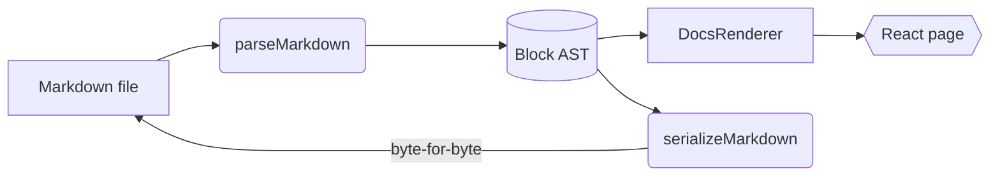


````md

````



The result pane is labelled **Pele** and carries two extras: an **Open in Playground** link that opens the diagram in Pele's online editor (for sources short enough to fit in a URL), and the time Pele took to draw it. Diagrams use the page's font and theme colours, and redraw nothing when the theme flips. A wide left-to-right chart in a narrow pane turns top-down instead of shrinking.

### Try it

The `Mermaid` component behind every mermaid fence, wired to a text box:



### A gallery

Pele understands most of Mermaid's diagram types. A selection, each as you'd write it:



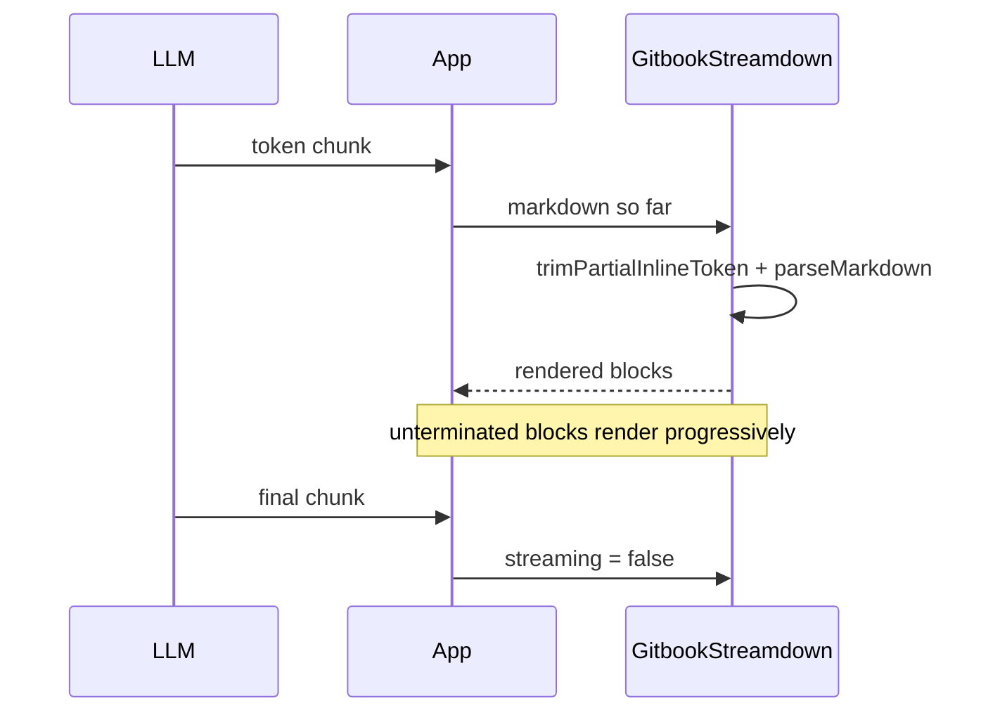


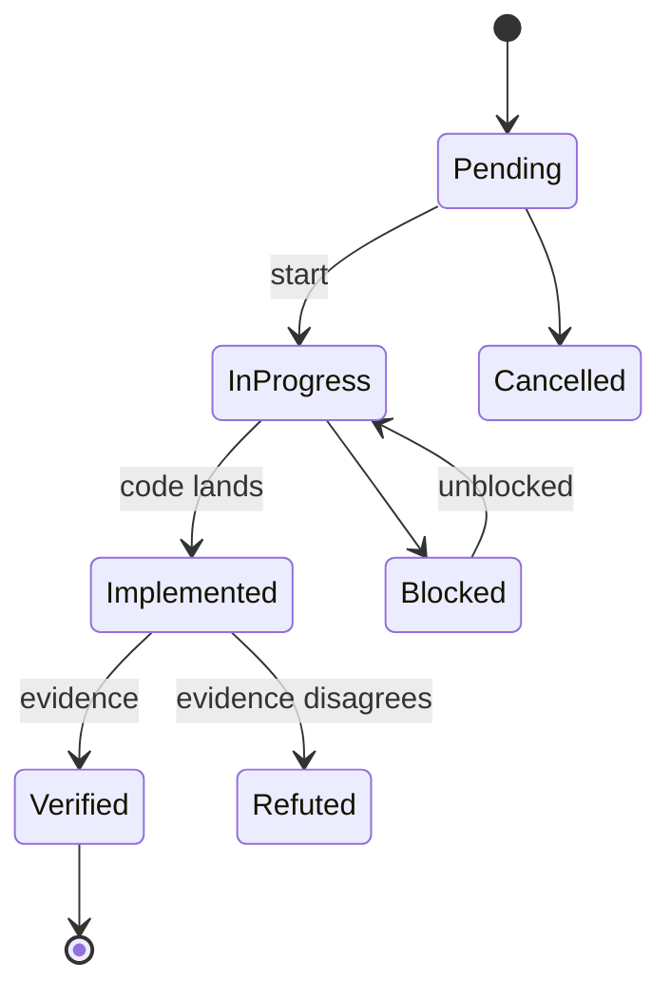


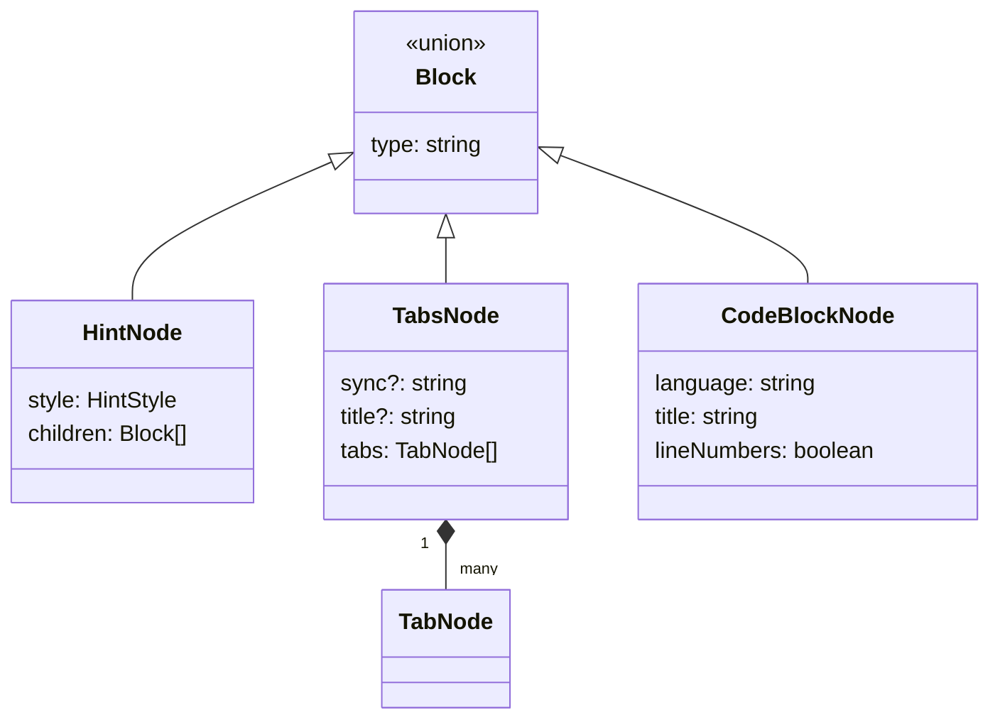


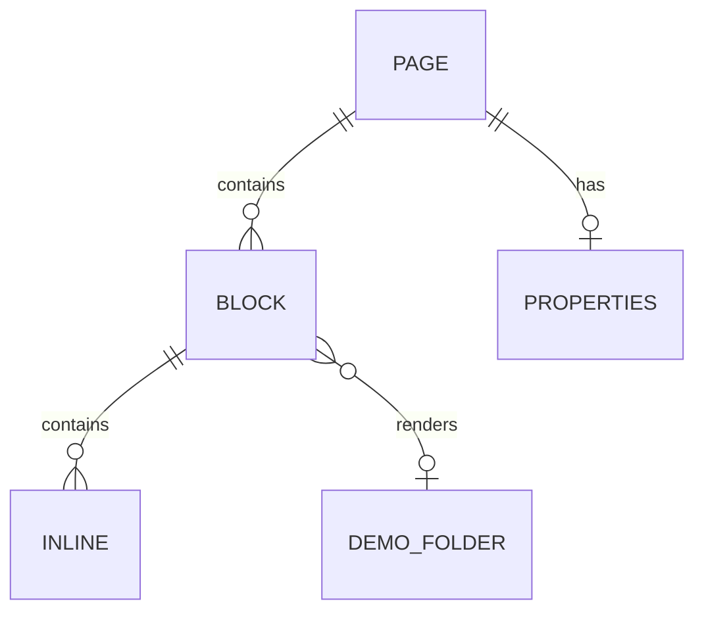


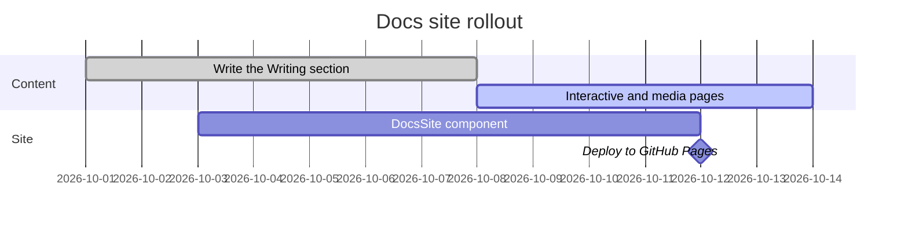


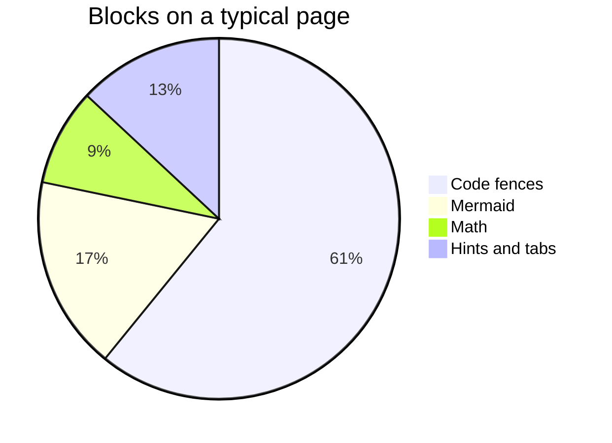


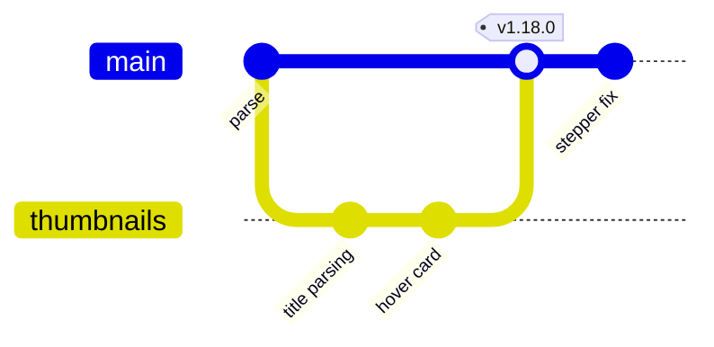


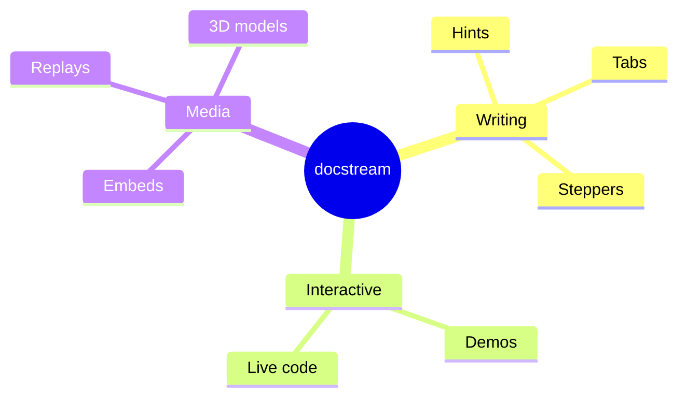


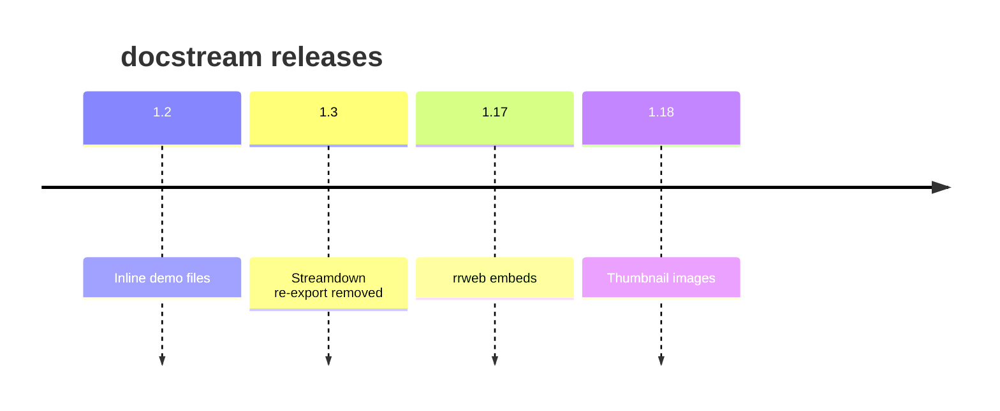


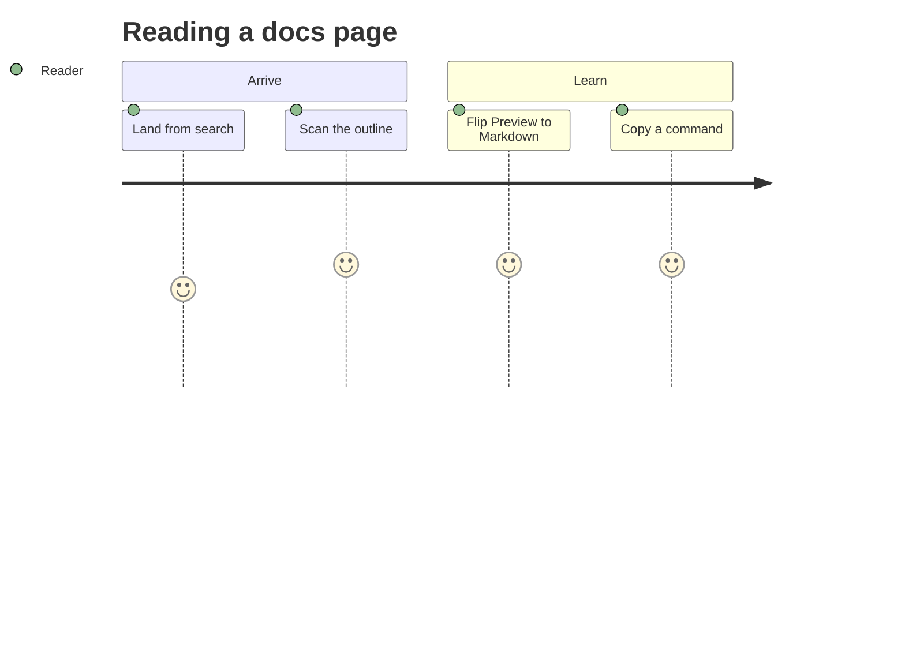


```mermaid
xychart-beta
  title "Render time by page size"
  x-axis [10, 50, 100, 200, 400]
  y-axis "ms" 0 --> 40
  line [1.2, 4.8, 9.1, 17.5, 33.0]
```


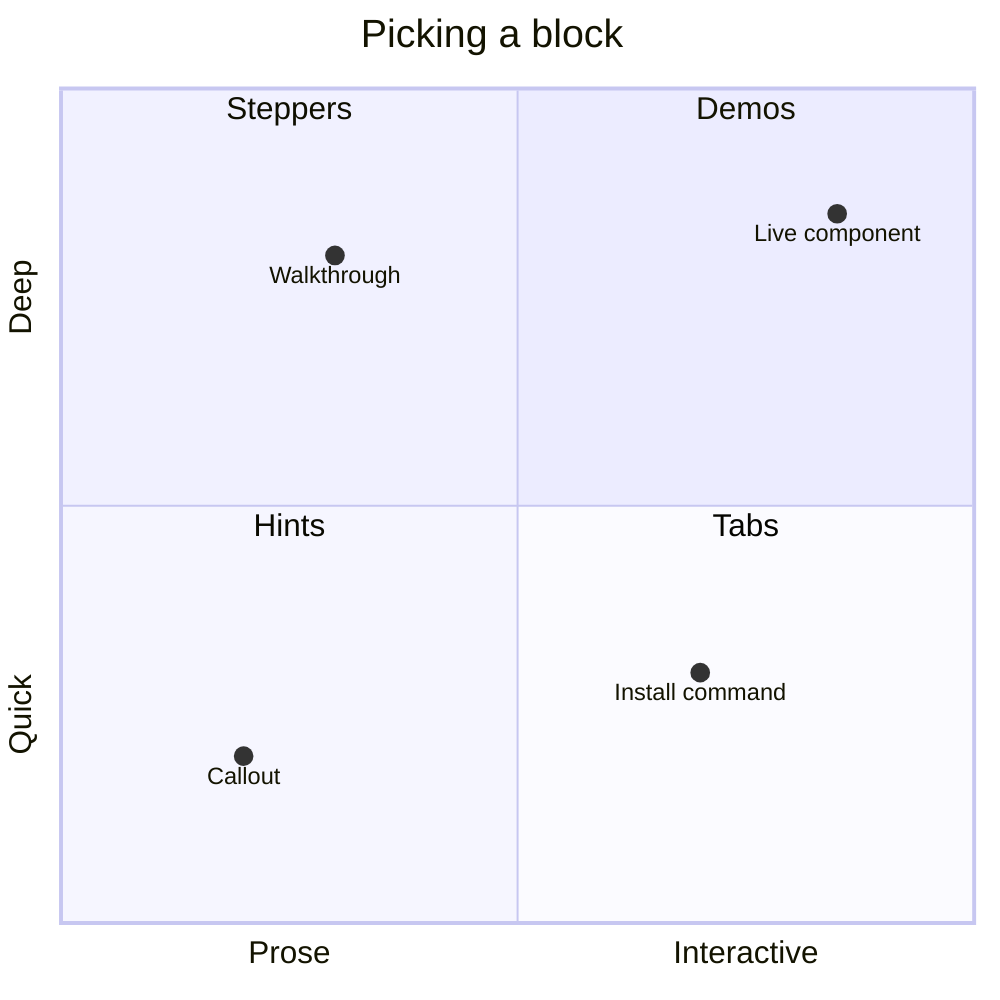


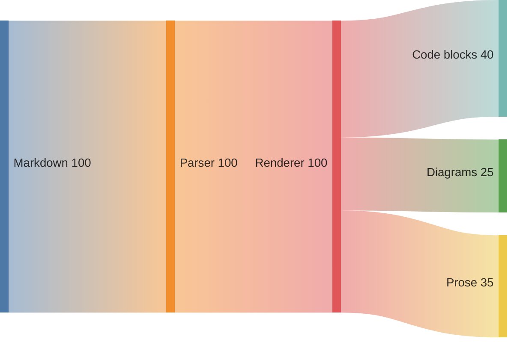



Beyond these, Pele draws requirement, C4, block, packet, kanban, architecture, radar, treemap and more — see [pele.run](https://pele.run) for the full list.

### Diagram edge cases

- The fence language must be exactly `mermaid`. Its source pane always shows the whole diagram; `collapsedCodeLines` / `expandedCodeLines` are accepted on mermaid fences for older documents and have no effect.
- A syntax error shows Pele's message in place of the drawing (as text — never as markup), and the source pane still shows what you wrote.
- A tab set whose tabs are all mermaid fences stays a normal tab set — each tab gets its own card — rather than [collapsing](02-callouts-and-tabs.md#code-only-tabs-collapse) into one code block.
- Very long sources don't fit in a URL, so their card has no **Open in Playground** link.

## XState statecharts

An `xstate` fence accepts a JSON machine config or static TypeScript `createMachine(...)` / `setup(...).createMachine(...)` source, and draws it with the library's [StateDiagram](https://blamy.github.io/ui/#/state-diagram), read-only: the same reading and the same picture as a StateDiagram in an app. Docstream reads the machine without running imports, actions, guards or context initializers. Dynamic state definitions, computed keys and spreads show an inline error. XState resolves nested and `#id` targets, ELK lays it out top to bottom, and the board follows the page theme.

```xstate
import { createMachine } from "xstate"

export const request = createMachine({
  id: "request",
  initial: "idle",
  states: {
    idle: { on: { FETCH: { target: "loading", actions: "showSpinner" } } },
    loading: { entry: "trackRequest", tags: ["busy"], invoke: { src: "fetchPage", onDone: "success", onError: "failure" } },
    failure: { on: { RETRY: { target: "loading", guard: "canRetry" } } },
    success: { type: "final" }
  }
})
```

The machine is a container with its name and its context (with the types `setup({ types })` gives it); a state is a card whose header is its name, with sections of chips for its entry and exit actions, what it invokes, its tags and meta; a transition's label is a pill with its event, or a card with its guard ("if canRetry") and actions under it. `after` has a clock, `always` a dashed line, an actor's `onDone` and `onError` say whose they are (`fetchPage: done`), and parallel regions, history states (H, H*) and final states (a square) are drawn too. An actor written inline, like `fromPromise(...)`, is only called `actor`, and neither it nor its `input` runs. The page on [StateDiagram](https://blamy.github.io/ui/#/state-diagram) has the table of what's drawn for each part of a machine.

Import `XStateDiagram` or the result-only `XStatePreview` from `@brett_lamy/ui/docstream/xstate` to use them directly (`appearance`: `auto`, `light` or `dark`). The diagram (`@brett_lamy/ui/state-diagram`), the parser, ELK and XState load only when a statechart is displayed; the board is styled by `@brett_lamy/ui/styles.css`. Where the diagram can't load, the fence shows its text form, a Mermaid statechart in UML's notation (`entry / onPlay` in a state, `event [guard] / action` on a transition), which `xstateToMermaid` on `@brett_lamy/ui/docstream/xstate/machine` writes. To read a config yourself, `parseXState` is on `@brett_lamy/ui/lib/state-diagram-source`. A StateDiagram takes the same source as `source`, to run and edit it.

## Workerd configs

A `capnp` fence that's a workerd config, `config.capnp`, draws as the Cloudflare services it runs: each Worker, its Durable Object classes, and what its bindings reach, on a read-only [`CloudflareDiagram`](https://blamy.github.io/ui/#/cloudflare-diagram). What isn't one of Cloudflare's services, like a disk, a socket or a plain value, is listed under it, and the source is a press away. Cap'n Proto that isn't a config, like a schema, stays code.

```capnp
using Workerd = import "/workerd/workerd.capnp";

const config :Workerd.Config = (
  services = [ (name = "main", worker = .main) ],
  sockets = [ (name = "http", address = "*:8080", http = (), service = "main") ],
);

const main :Workerd.Worker = (
  modules = [ (name = "worker.js", esModule = embed "worker.js") ],
  compatibilityDate = "2026-01-01",
  bindings = [ (name = "ROOMS", durableObjectNamespace = "Room"), (name = "CACHE", kvNamespace = "cache") ],
  durableObjectNamespaces = [ (className = "Room", uniqueKey = "rooms", enableSql = true) ],
  durableObjectStorage = (inMemory = ()),
);
```

A config in a file of its own is embedded, and drawn the same way, by its file name. The file goes through the host's [asset resolver](../05-media/06-assets.md), like a model or an image, so a path beside the page works in a repo and in a [`DocsSite`](../02-docs-site/04-loading-files.md):



```md

```

A config that doesn't read says where, and the source is still a press away:

```capnp
using Workerd = import "/workerd/workerd.capnp";

const config :Workerd.Config = (
  services = [ (name = "main", worker = .main ],
);
```

A host's [`renderCode`](05-code.md) is asked first, as for any code fence: return `null` and the config is drawn. The board is the library's own `CloudflareDiagram`, so the page needs the library's stylesheet, `@brett_lamy/ui/styles.css`, beside docstream's. It follows the page's light or dark scheme, as the terminal preview does; `appearance` (`"auto"`, `"light"` or `"dark"`) on `CapnpDiagram` sets it.

Import `CapnpDiagram`, the board alone as `CapnpPreview`, or the embed as `CapnpEmbed`, from `@brett_lamy/ui/docstream/capnp`. The reader is `readWorkerdConfig` on `@brett_lamy/ui/cloudflare`, which, with the diagram and its catalog, loads only when a config is displayed. Every service gets its place from `placeInLayers`, so no layout engine loads either.

## tscircuit examples

A `tscircuit` (or `ts-circuit`) fence renders TSX source beside schematic, PCB, and 3D views. The [RunFrame runtime](https://github.com/tscircuit/runframe) runs code in an isolated cross-origin iframe and worker; the hosted runtime requires a network connection. Regular `tsx` fences stay ordinary code.

```tscircuit
circuit.add(
  <board width="16mm" height="12mm">
    <resistor name="R1" resistance="1k" footprint="0402" pcbX={-3} schX={-2} />
    <capacitor name="C1" capacitance="100nF" footprint="0603" pcbX={3} schX={2} />
    <trace from=".R1 .pin1" to=".C1 .pin1" />
  </board>
)
```

`TsCircuit` and the result-only `TsCircuitPreview` are exported from `@brett_lamy/ui/docstream/tscircuit`. Both take `code`, an optional `title`, and an optional `runtimeUrl` for a compatible runtime hosted on a separate origin. Syntax errors are shown as text; editing the source sends it to the existing frame. Load failures show a retry button.

## Split cards

Math and diagrams share one layout, the **split card**. It is a size container: when the card is at least **640px** wide, source and result sit side by side; narrower — a phone, a column, a demo pane — the source stacks above the result. The breakpoint follows the card's own width, not the window's, so a diagram inside a [column](04-layout.md#columns) stacks even on a wide screen:



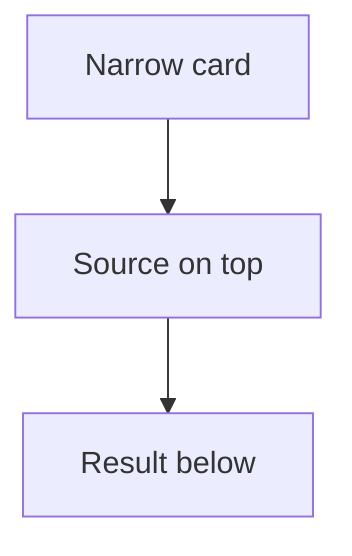


$$
c = \sqrt{a^2 + b^2}
$$



The card is exported as `SplitCard`, `SplitSource` and `SplitResult` — the same pieces work for any source-and-output pair of your own:

```tsx title="RegexCard.tsx"
import { SplitCard, SplitResult, SplitSource } from "@brett_lamy/ui/docstream"

export function RegexCard({ pattern, sample }: { pattern: string; sample: string }) {
  const matches = sample.match(new RegExp(pattern, "g")) ?? []
  return (
    <SplitCard>
      <SplitSource label="RegExp" code={pattern} language="regex" />
      <SplitResult label={`${matches.length} matches`}>
        <pre>{matches.join("\n")}</pre>
      </SplitResult>
    </SplitCard>
  )
}
```

## Next


Changelogs — dated release notes with ``

