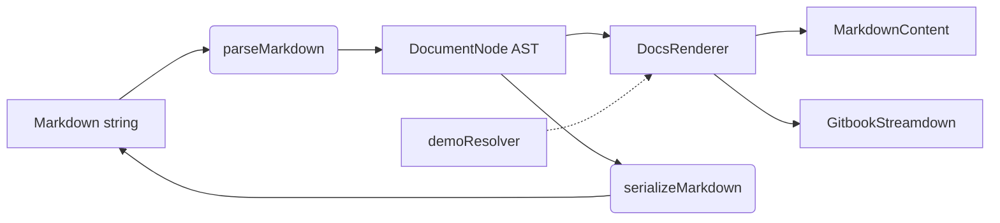

# Quick start

This page takes you from nothing to the three things docstream is built for: rendering a GitBook-flavored page, streaming an AI answer into the same renderer, and putting live, file-backed React demos into Markdown.


**You need** a React 18+ app with a bundler that handles CSS imports (Vite, Next.js, webpack…). Every example below is running on this page — it's rendered by docstream too.




### Install the package

npm install @brett_lamy/docstream

React and React DOM are peers and come from your app. Optional extras (the almost-node playground, the viz engine) are covered in [Installation](01-installation.md).



### Import the stylesheet once

```tsx title="main.tsx" lineNumbers="false"
import "@brett_lamy/docstream/styles.css"
```

The styles read shadcn-style tokens (`--card`, `--border`, `--primary`…) when your app defines them and fall back to a neutral light theme when it doesn't. Nothing else to configure.



### Render a page

`MarkdownContent` parses a string and renders it — GFM plus every GitBook block.

```tsx title="Page.tsx"
import { MarkdownContent } from "@brett_lamy/docstream"

export function Page({ markdown }: { markdown: string }) {
  return <MarkdownContent markdown={markdown} />
}
```



Parse once and render many times? Use `parseMarkdown` + `DocsRenderer` instead; the AST is plain JSON you can store, diff and edit ([Parser API](../07-reference/02-parser-api.md)).



### Stream an answer

`GitbookStreamdown` takes the markdown you have so far. Pass the growing string on every chunk and set `isStreaming` until the stream ends.

```tsx title="Answer.tsx"
import { GitbookStreamdown } from "@brett_lamy/docstream"

export function Answer({ text, done }: { text: string; done: boolean }) {
  return <GitbookStreamdown markdown={text} isStreaming={!done} />
}
```



There is no separate streaming parser. The whole partial document is re-parsed on each update, and the parser is tolerant of unterminated input: an open hint or fence collects everything to the end of the input and renders as it grows. While `isStreaming` is set, a half-arrived inline token (`[^1`, `@da`, a block tag still being typed) is held back so it never flashes as plain text. More in [Streaming](../06-ai/01-streaming.md).



### Put live demos in your Markdown

A demo is a folder: `examples/<page>/<example>/index.tsx` default-exports a component, and any other files beside it are shown in the Code view. Tell docstream where the folders are with a resolver built from three `import.meta.glob` maps:

```tsx title="demos.ts"
import { createGlobDemoResolver } from "@brett_lamy/docstream"

export const demoResolver = createGlobDemoResolver({
  root: "./examples",
  modules: import.meta.glob("./examples/*/*/index.tsx"),
  sources: import.meta.glob("./examples/*/*/**/*.{ts,tsx,css,json}", { query: "?raw", import: "default" }),
  metas: import.meta.glob("./examples/*/*/meta.json", { eager: true, import: "default" }),
})
```

```tsx title="Page.tsx"
<MarkdownContent markdown={page} demoResolver={demoResolver} pageActions />
```

Now `` in any page renders that folder — exactly how the two demos above are wired. `pageActions` adds the **Copy page ▾** menu: the copied Markdown carries each demo's real files inline, so it renders the same page anywhere, resolver or not. See [Demos](../04-interactive/01-demos.md).



## What you just used



`MarkdownContent` and `GitbookStreamdown` both parse with `parseMarkdown` and render through `DocsRenderer`. The AST round-trips: `serializeMarkdown(parseMarkdown(md)) === md`, byte for byte.

## Next steps

<table data-view="cards"><thead><tr><th></th><th></th></tr></thead><tbody>
<tr><td><strong>Write pages</strong></td><td>Hints, tabs, steppers, columns, code, math, diagrams, changelogs — every block, demonstrated. <a href="../03-writing/01-markdown-basics.md">Writing →</a></td></tr>
<tr><td><strong>Interactive demos</strong></td><td>Folder demos, inline-file demos, live code fences and real source files. <a href="../04-interactive/01-demos.md">Interactive →</a></td></tr>
<tr><td><strong>Media</strong></td><td>Video, session replays, 3D models, live music, OpenAPI operations. <a href="../05-media/01-embeds-and-video.md">Media →</a></td></tr>
<tr><td><strong>AI answers</strong></td><td>Streaming, citations with hovercards, mentions, Copy page for LLMs. <a href="../06-ai/01-streaming.md">AI →</a></td></tr>
<tr><td><strong>Docs site</strong></td><td>Turn a folder of <code>.md</code> files into a site like this one. <a href="../02-docs-site/README.md">Docs site →</a></td></tr>
<tr><td><strong>Reference</strong></td><td>Theming tokens, parser API, AST, component props, the Vite plugin. <a href="../07-reference/04-components.md">Reference →</a></td></tr>
</tbody></table>


Package entries — every subpath export, what it pulls in, and when to use it

