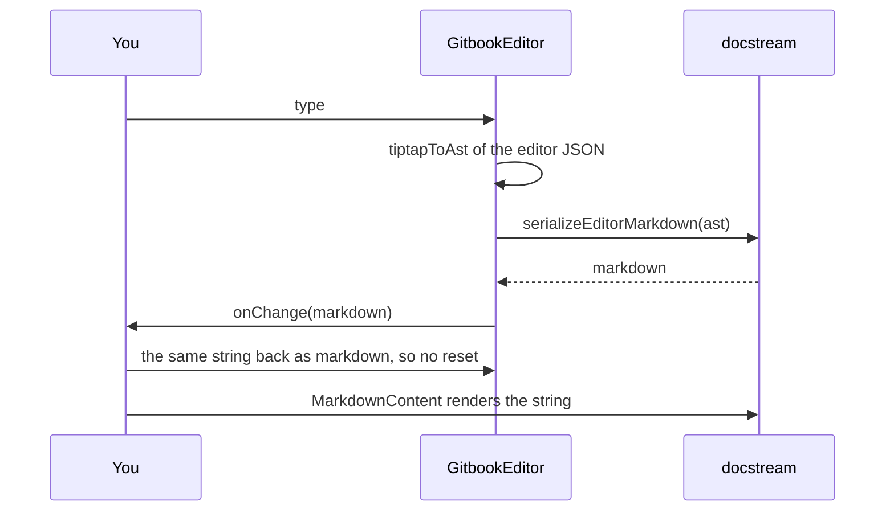

# Quick start

By the end of this page you'll have the editor writing Markdown and docstream rendering it, side by side, from one piece of React state. That's the whole integration: the editor takes a string and gives you a string back.


**You need** a React 18+ app with a bundler that handles CSS imports (Vite, Next.js, webpack…). Every editor on this page is running live.




### Install the editor and its peers

npm install @brett_lamy/docstream-editor @tiptap/core @tiptap/extension-code @tiptap/extension-code-block @tiptap/extension-list @tiptap/extension-placeholder @tiptap/extension-table @tiptap/pm @tiptap/react @tiptap/starter-kit @tiptap/suggestion

React and the Tiptap packages are peers. `@brett_lamy/docstream` installs with the editor, at the same version. The peer table is in [Installation](01-installation.md).



### Import both stylesheets once

```tsx title="main.tsx" lineNumbers="false"
import "@brett_lamy/docstream/styles.css"
import "@brett_lamy/docstream-editor/styles.css"
```

docstream's stylesheet covers the renderer pieces the editor reuses (demo previews, command boxes, diagrams). The editor's covers its own chrome. Both read your theme's `--card` / `--border` / `--primary` tokens when you have them.



### Render a controlled editor

`GitbookEditor` is controlled, like an `<input>`: pass `markdown` and take the next value from `onChange`.

```tsx title="EditorPage.tsx"
import { useState } from "react"
import { GitbookEditor } from "@brett_lamy/docstream-editor"

const initial = `# Getting started


Type / to insert a block.

`

export function EditorPage() {
  const [markdown, setMarkdown] = useState(initial)
  return <GitbookEditor markdown={markdown} onChange={setMarkdown} />
}
```

`onChange` fires on every edit with the serialized Markdown. The editor remembers the last string it emitted, so passing that string back as `markdown` doesn't reset anything: no caret jumps, no loops. Passing a *different* string (you opened another file) replaces the document, without firing `onChange`.

You can also leave out `markdown` for an uncontrolled editor that starts empty. It still reports edits through `onChange`.



### Render the same string with docstream

The renderer takes the same string. No conversion step in between:

```tsx title="EditorPage.tsx"
import { MarkdownContent } from "@brett_lamy/docstream"

export function EditorPage() {
  const [markdown, setMarkdown] = useState(initial)
  return (
    <div style={{ display: "grid", gridTemplateColumns: "1fr 1fr", gap: 16 }}>
      <GitbookEditor markdown={markdown} onChange={setMarkdown} />
      <MarkdownContent markdown={markdown} />
    </div>
  )
}
```



Type in the left pane, or press `/` and insert a stepper. The right pane is docstream rendering the editor's output.



## Turn the knobs

A few props cover most setups. All of them are on [Props](../04-reference/01-props.md):

| You want | Pass |
| --- | --- |
| A read-only view that looks like the editor | `editable={false} toolbar={false}` |
| No formatting toolbar | `toolbar={false}` |
| Your own `/` menu | `slashMenu={{ items }}`, or `slashMenu={false}` for none |
| People and channels in `@` / `#` | `references={{ mentions, tags }}` |
| Hide the frontmatter sheet | `documentProperties={false}` |
| Pasted images as chips the host stores | `imagePaste="chip"` + `attachments` / `onAttachmentAdd` |
| Live `` previews | `demoResolver={…}` (the same resolver your docstream pages use) |
| The Tiptap instance, for commands | `onEditorReady={setEditor}` |

## What happens on each keystroke



## Next steps

<table data-view="cards"><thead><tr><th></th><th></th></tr></thead><tbody>
<tr><td><strong>With docstream</strong></td><td>One AST, a byte-for-byte round trip, and the version rule that keeps them in step. <a href="03-with-docstream.md">With docstream →</a></td></tr>
<tr><td><strong>Editing</strong></td><td>Every block, the slash menu, chips and citations, code and diagrams, tables, properties. <a href="../02-editing/01-editing-surface.md">Editing →</a></td></tr>
<tr><td><strong>Files and demos</strong></td><td>Images and attachments, the host's files, real source files, live demo blocks. <a href="../03-files-and-demos/01-images-and-attachments.md">Files and demos →</a></td></tr>
<tr><td><strong>Reference</strong></td><td>Props, conversion helpers, theming tokens, bundler and migration notes. <a href="../04-reference/01-props.md">Reference →</a></td></tr>
</tbody></table>
