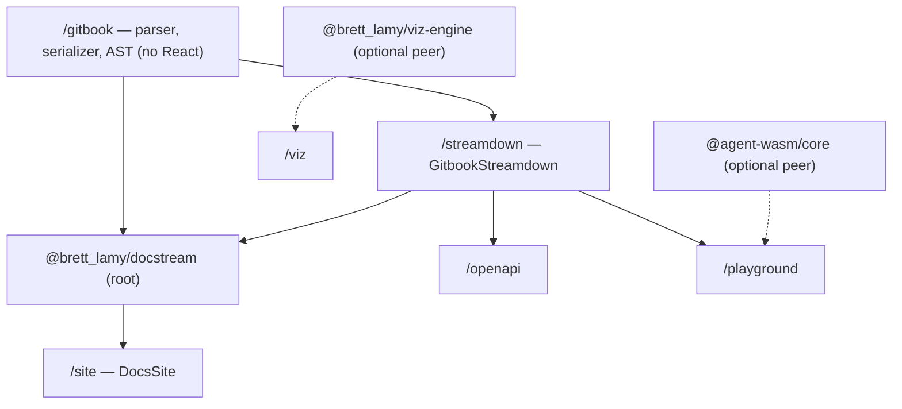

# Package entries

`@brett_lamy/docstream` is one package with 23 exports: the root and 22 subpaths. The root has nearly everything; the narrower entries let a host import only the layer it needs — a server that only parses, an answer pane that only streams, a page that only plays a replay. Two entries are behind **optional** peer dependencies, and nothing else in the package ever imports them.

Arrows point from a layer to the entries built on it; dotted arrows are optional peers.

## At a glance

| Import | What you get | Imports eagerly | Loads on demand |
| --- | --- | --- | --- |
| `@brett_lamy/docstream` | Most of the API: renderers, embeds, demos, parser. Not `/playground`, `/viz`, `/vite`, the replay stage/timeline helpers or the Strudel studio internals | react, react-dom, framer-motion, lucide-react, react-aria, gpu-lexer, yaml | pele, katex, rrweb, @strudel/web, acorn |
| `/gitbook` | Parser, serializer, AST types, pure helpers | yaml | — |
| `/streamdown` | `GitbookStreamdown` + the context/actions it needs | same as root | pele, katex, rrweb, @strudel/web, acorn |
| `/properties` | `DocumentProperties` | react, lucide-react, yaml | — |
| `/properties/styles.css` | Property sheet styles | — | — |
| `/tasks` | `TaskCheckbox`, `TASK_STATE_ICONS` | react, react-dom, lucide-react | — |
| `/tasks/styles.css` | Task checkbox styles | — | — |
| `/reference` | Mention/tag/citation chips and their context | react, lucide-react | — |
| `/assets` | Asset URL resolution | react | — |
| `/openapi` | `OpenApiOperation` | same as root (descriptions render as docstream Markdown) | same as root |
| `/replay` | Replay player, headless stage, timeline helpers | react, framer-motion, lucide-react | rrweb |
| `/replay/demo` | `replayDemoEvents` sample recording | — | — |
| `/video` | `VideoEmbed` | react | — |
| `/stl` | `StlViewer`, `parseStl`, `isStlUrl` | react | — |
| `/strudel` | Strudel player, rack, controls, syntax tree and edit helpers | react, lucide-react, gpu-lexer, acorn | @strudel/web |
| `/viz` | `VizEmbed` | **@brett_lamy/viz-engine** (+ its stylesheet) | — |
| `/playground` | almost-node live previews | same as root | **@agent-wasm/core**, plus root's lazy set |
| `/source` | Source-file clients and `SourcePreview` | react | — |
| `/demo` | Demo viewer, resolvers, VFS, clipboard, Markdown resolution | react, react-dom, framer-motion, lucide-react, react-aria, gpu-lexer | — |
| `/site` | `DocsSite`, `buildDocsTree`, docs search — a site from a folder of Markdown ([Docs sites](../02-docs-site/README.md)) | same as root, plus yaml | same as root |
| `/site/styles.css` | Site chrome styles alone (already inside `/styles.css`) | — | — |
| `/vite` | `docstreamSources` Vite plugin (Node-only) | vite, node:fs, node:path | — |
| `/styles.css` | The full stylesheet | — | — |

The "imports" columns are third-party packages reachable from each entry's module graph (React's JSX runtime aside). Everything ships as one ES module per source file in `dist/`, so a bundler tree-shakes within an entry as well.

## Bundle boundaries

These aren't conventions — `src/entry-boundary.test.ts` checks them on every test run, against both the TypeScript sources and the published `dist/`:

- **almost-node stays in `/playground`.** For every other entry, the test walks static, type-only and dynamic imports and fails if `@agent-wasm/*` — or any `playground/` module other than the plain-data `playground/project` — is reachable.
- **Optional peers only from their own entry.** `@brett_lamy/viz-engine` may be imported only by `/viz`; every bare import must be a declared dependency or peer.
- **rrweb is lazy everywhere.** No entry may import `rrweb` statically. It stays a regular dependency (not a peer), because the root's `ReplayPreview` plays event lists and every bundler must be able to resolve its lazy import.
- **acorn is lazy outside `/strudel`.** The Strudel rack's parser loads when a reader opens the rack.
- **Plain Node can load `dist/`.** Every entry except `/playground` and `/viz` is imported in a bare `node` process — fully specified relative imports, no stylesheet imports on the eager path — so SSR, a host's vitest and the `/vite` plugin work without a bundler.
- **`dist/` mirrors `src/`.** Each export resolves `import` to `./dist/….js` and `types` to `./dist/….d.ts`, with the TypeScript source behind a `source` condition.

## The entries

### `@brett_lamy/docstream`

The renderers (`GitbookStreamdown`, `MarkdownContent`, `DocsRenderer`, `MathFormula`), page actions, code/copy primitives, task and property components, citations and chips, every embed component (replay, video, STL, Strudel player, OpenAPI), Mermaid/Pele and split cards, thumbnails, the demo system, source clients, asset resolution, and the full parser/serializer API. It also re-exports `createInlineDemoProject` and `createReactDemoFiles` — plain-data helpers that never touch almost-node.

**Use it** when you're building a docs page or an app that renders documents. It's what most hosts import.


The root's `GitbookStreamdown` renders live code fences as highlighted code, and inline-file demos on their Code view, unless you pass a `liveRenderer` / `demoRuntime`. For the batteries-included version import it from `/playground`.


### `/gitbook`

The pure engine: `parseMarkdown`, `parseBlocks`, `parseInline`, `serializeMarkdown`, `serializeBlocks`, `serializeInline`, `plainText`, `refDefinitions`, `footnoteDefinitions`, `documentOutline`, `slugify`, `flattenForPlainMarkdown`, `packageManagerCommands`, property and task helpers, attribute escaping (`escapeAttr` / `unescapeAttr`), fence scanning (`fenceOpener`, `closesFence`, `fenceTracker`, `fenceFor`), demo helpers (`demoBody`, `parseDemoVariants`, `serializeDemoFile`), `thumbnailLabel`, `stepTitleText`, and every AST type. No React, no DOM.

**Use it** on a server, in a Worker, in an AI agent that writes or edits docs, or in build scripts (`llms.txt`, search indexes). See [Parser API](../07-reference/02-parser-api.md).

### `/streamdown`

`GitbookStreamdown` and its props type, plus what a markdown-only answer pane needs alongside it: `DocstreamRefContext`, `InlineReference`, `CitationSources`, `DocPageActions`, `DocstreamDemoContext`, `DocstreamDemoRuntimeContext`, `DemoViewer`, `DemoFullscreen`, and the demo/citation types.

**Use it** for an AI chat surface that doesn't need the rest of the root's API surface in scope.

### `/properties` and `/tasks`

`DocumentProperties` (the YAML frontmatter sheet, editable with `onChange`) and `TaskCheckbox` (the eight-state task control) as standalone components, each with its own stylesheet entry. The full `styles.css` already includes both stylesheets.

**Use them** in an editor or app UI that shows properties or task states outside a rendered document.

### `/reference` and `/assets`

`/reference`: `DocstreamRefContext`, `InlineReference`, `CitationSources` and the `CitationPreview` types — for custom chip handling. `/assets`: `setAssetBase`, `resolveAsset`, `AssetResolverProvider`, `AssetResolverContext`, `useAsset` — for resolving relative image, STL and Strudel URLs.

### `/openapi`

`OpenApiOperation` — fetches a spec (JSON or YAML), resolves refs and renders one operation. It pulls in the renderer because operation descriptions are themselves rendered as docstream Markdown. See [OpenAPI](../05-media/05-openapi.md).

### `/replay` and `/replay/demo`

`ReplayPreview` / `ReplayEmbed`, `ReplayFile`, `formatReplayTime`, the headless `ReplayStage` and `preloadReplayStage`, the rrweb-free timeline helpers (`getReplayMeta`, `getReplayMarkers`, `getReplayPointerTrack`, `replayPointerAt`), event-type enums, URL helpers (`isReplayQaUrl`, `normalizeReplayEmbedUrl`, `isRrwebUrl`) and `sanitizeReplayEvent`. `/replay/demo` holds `replayDemoEvents`, a small synthetic recording kept out of the main entry. See [Replays](../05-media/02-replays.md).

### `/video`, `/stl`, `/strudel`

`VideoEmbed` (native video or iframe player). `StlViewer` with `parseStl` and `isStlUrl` — a dependency-free WebGL model viewer. `/strudel` is the whole music studio: `StrudelPlayer`, `StrudelRack`, `RackGrid`, `StepGrid`, `Knob`, `Fader`, the engine (`playStrudel`, `stopStrudel`, `updateStrudel`, `subscribeStrudel`, …) and the syntax tree with exact source edits (`parseStrudel`, `parseMini`, `setMethod`, `mixCode`, …). The root exports only `StrudelPlayer`, `isStrudelFile` and `isStrudelLanguage`. See [3D models](../05-media/03-3d-models.md) and [Music](../05-media/04-music.md).

### `/viz`

`VizEmbed`, for mounting a deterministic `@brett_lamy/viz-engine` scene. Install the optional peer first. It imports the engine's stylesheet itself, which is why it's excluded from the plain-Node check. See [Viz](../05-media/07-viz.md).

### `/playground`

The only entry that touches almost-node: `PlaygroundStreamdown` (also exported as `GitbookStreamdown`), `almostNodeLiveRenderer`, `ReactDemo` / `ReactCodePreview`, `useAlmostNodeServer`, `InlineDemoPreview`, `almostNodeDemoRuntime` / `createAlmostNodeDemoRuntime`, and the filesystem helpers (`createAlmostNodeFilesystem`, `createAlmostNodeWorkspace`, `normalizeAlmostNodeFiles`, …). `@agent-wasm/core` is imported type-only and then with a dynamic `import()`; if it isn't installed, starting a preview fails with an error that says to install it.

**Use it** when readers should run code: live fences and inline-file demos. See [Live code](../04-interactive/03-live-code.md).

### `/source` and `/vite`

`/source`: `createViteSourceClient`, `createBundledSourceClient`, `SourcePreview` and the provenance types — the browser side of rendering real component and story files. `/vite`: the `docstreamSources` plugin that serves those files from the dev server. See [Vite plugin](../07-reference/05-vite-plugin.md).

### `/demo`

The demo system on its own: `DemoViewer`, `DemoFullscreen`, `DemoBlock`, `createGlobDemoResolver`, `demoHref` / `demoFromSearch`, the demo VFS (`createDemoVFS`, `useDemoVFS`, …), clipboard helpers (`createDocstreamClipboard`, `writeDocstreamClipboard`, `readDocstreamClipboard`, …), `CopyDemoButton` / `useDocstreamCopy`, `resolveDemosToMarkdown`, `inlineDemoMarkdown`, `preloadDemos`, `prefetchDemoSources`, `peekDemoSource`, and `surfaceToCss` / `cssToSurface`. Several of these (the clipboard writer, `useDocstreamCopy`, `demoNodeMeta`, the surface helpers) are only exported here, not from the root.

`createGlobDemoResolver` is plain TypeScript over `import.meta.glob` maps, so it lives here and on the root — not in the Node-only `/vite` entry.

### `/styles.css`

One stylesheet for every block. Import it once. See [Theming](../07-reference/01-theming.md).

## Choosing an entry

| You are building… | Import from |
| --- | --- |
| A docs site or in-app docs | root + `styles.css` |
| An AI answer pane | `/streamdown` (or root) |
| …where readers run the code the model wrote | `/playground` + `@agent-wasm/core` |
| A server route, Worker or agent that reads/writes Markdown | `/gitbook` |
| A build step that writes `llms.txt` with demo sources inlined | `/demo` (`resolveDemosToMarkdown`) + `/gitbook` |
| A QA dashboard that only plays recordings | `/replay` |
| A component gallery backed by real files | `/vite` in `vite.config.ts`, `/source` in the app |
