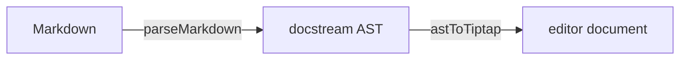

# Code, math and diagrams

Each of these blocks is edited as source with the result next to it. Fences keep their attributes in a header row. A command box shows docstream's own box above its fields. Math and Mermaid use docstream's split cards: the source on one side and the typeset result on the other, redrawn shortly after you stop typing.



## Code blocks

Make one with ```` ``` ```` (or `~~~`) at the start of a line, with an optional language (```` ```ts ````), then a space or Enter. You can also use `/code` or `Mod`+`Alt`+`C`. The code is plain text: type, paste and indent freely. To leave the block, press `Enter` three times at the end, or `↓` on the last line.

Every code block has a header with four controls, each tied to a fence attribute:

| Control | Fence attribute | Notes |
| --- | --- | --- |
| **Title** field | `title="greet.ts"` | Empty removes it. The filename header readers see. |
| **lang** field | the info string (```` ```ts ````) | Changing it to `mermaid` turns the block into a [diagram](#mermaid-diagrams). |
| **#** checkbox | `lineNumbers="…"` | Starts as the fence renders: on for a titled fence, off for an untitled one. The attribute is written only when you differ from that default. |
| **Live** checkbox | `live="true"` | Shows an **entry** field (`entry="…"`). See [Live fences](#live-fences). |

````md
```ts title="greet.ts" lineNumbers="true"
export function greet(name: string): string {
  return `Hello, ${name}!`
}
```
````

- **Attributes you don't touch are kept as written**, including `collapsedCodeLines`, `expandedCodeLines` and an explicit `lineNumbers="false"`. The legacy `` wrapper keeps its wrapper.
- **Fence spelling is kept**: backticks vs tildes, fence length, and longer outer fences around nested ones.
- **Syntax highlighting** comes from [gpu-lexer](https://gpu-lexer.vercel.app/), the language-agnostic WebGPU lexer docstream's renderer uses, so the editor and the page agree. It loads on the first code block. It is cached by block text, and it re-highlights in the background as you type. Without WebGPU, code stays plain text and is still fully editable.

For how fences render on the published page (copy buttons, collapsing, the full attribute list), see docstream's [Code](https://blamy.github.io/docstream/#/writing/code) page.

### Live fences

A `jsx`, `tsx` or `react` fence with `live="true"` runs as a React preview in docstream's renderer. In the editor it runs only when the host passes a `liveRenderer`, such as `almostNodeLiveRenderer` from `@brett_lamy/docstream/playground`. The preview then sits above the source and refreshes after a short pause in typing. The editor never loads that runtime itself. Without it, as on this site, a live fence is edited as ordinary code and keeps its `live` and `entry` attributes.

```tsx title="Editor.tsx"
import { GitbookEditor } from "@brett_lamy/docstream-editor"
import { almostNodeLiveRenderer } from "@brett_lamy/docstream/playground"

<GitbookEditor markdown={md} onChange={setMd} liveRenderer={almostNodeLiveRenderer} />
```

The entry defaults to `/src/main.tsx` for `tsx` and `/src/main.jsx` otherwise. Live fences and the `` blocks they relate to are covered in [Demo blocks](../03-files-and-demos/04-demo-blocks.md).

### Strudel fences

A `strudel` fence (or `/strudel`) gets docstream's Strudel player above its source, so a music pattern plays from the editor as it does on the page. See docstream's [Music](https://blamy.github.io/docstream/#/media/music) page.

## Install commands

`npm install x` is one npm command shown in the reader's package manager. In the editor the block is docstream's real command box, with its pnpm / npm / yarn / bun switch and copy button, above the fields that edit it:



| Field | Writes |
| --- | --- |
| **npm** | The command itself. Several lines switch the block to its multi-line form. |
| **pnpm**, **yarn**, **bun** | A verbatim override (`pnpm="…"`). The placeholder shows what docstream would derive. Leave it empty to keep deriving. |

Insert a box with `/install` (the **Install command** item). A `sync` key is kept as written. docstream's [install commands](https://blamy.github.io/docstream/#/writing/code) section has the full derivation table.

## Math

A `$$` block is a math card: **LaTeX** on the left, **KaTeX** on the right (stacked when narrow), as in docstream. Edit the TeX and the result redraws after a short pause. An invalid formula shows KaTeX's error in place. Insert one with `/math`. It starts as `e = mc^2`.



````md
$$
\int_{-\infty}^{\infty} e^{-x^2}\,dx = \sqrt{\pi}
$$
````

The result pane is docstream's `MathFormula` component, so the editor and the published page typeset with the same KaTeX build and settings. Math is display math only: docstream has no inline `$…$` form, and a `$` before a letter in prose is a [codebase chip](03-references-and-citations.md). See docstream's [Math and diagrams](https://blamy.github.io/docstream/#/writing/math-and-diagrams) page.

## Mermaid diagrams

A `mermaid` fence is a diagram card: the editable source on the left, docstream's Pele diagram on the right, redrawn after a short pause in typing. Start one with ```` ```mermaid ````, `/mermaid` (the **Mermaid diagram** item, seeded with `graph TD`), or by changing an existing code block's language to `mermaid`.



````md

````

The diagram is `PeleDiagram`, the same component docstream's renderer draws with, so a diagram that renders in the editor renders on the page. The diagram types Pele draws, with a gallery, are on docstream's [Math and diagrams](https://blamy.github.io/docstream/#/writing/math-and-diagrams) page.

## Next


[Tables and layout](05-tables-and-layout.md)

