# Math and diagrams

Equations and diagrams are written as text and drawn on the page. Both render as a **split card**: the source on the left with a copy button, the result on the right — so readers can see how a diagram was made and lift it into their own docs. Neither costs anything on pages that don't use it: KaTeX and Pele load the first time a page needs them.

## Math

Put TeX between two `$$` lines:



$$
\int_{-\infty}^{\infty} e^{-x^2}\,dx = \sqrt{\pi}
$$


````md
$$
\int_{-\infty}^{\infty} e^{-x^2}\,dx = \sqrt{\pi}
$$
````



The left pane is labelled **LaTeX**, the right **KaTeX**. Anything KaTeX supports works — matrices, aligned equations, cases, colour:



$$
\begin{aligned}
\nabla \cdot \mathbf{E} &= \frac{\rho}{\varepsilon_0} \\
\nabla \cdot \mathbf{B} &= 0 \\
\nabla \times \mathbf{E} &= -\frac{\partial \mathbf{B}}{\partial t} \\
\nabla \times \mathbf{B} &= \mu_0 \mathbf{J} + \mu_0 \varepsilon_0 \frac{\partial \mathbf{E}}{\partial t}
\end{aligned}
$$

$$
\operatorname{softmax}(\mathbf{z})_i = \frac{e^{z_i}}{\sum_{j=1}^{K} e^{z_j}}
\qquad
\mathbf{A} = \begin{pmatrix} 1 & 2 \\ 3 & 4 \end{pmatrix}
$$

$$
|x| = \begin{cases} x & \text{if } x \ge 0 \\ -x & \text{otherwise} \end{cases}
\qquad
{\color{#5b5bd6} e^{i\pi} + 1 = 0}
$$


````md
$$
\begin{aligned}
\nabla \cdot \mathbf{E} &= \frac{\rho}{\varepsilon_0} \\
\nabla \cdot \mathbf{B} &= 0 \\
\nabla \times \mathbf{E} &= -\frac{\partial \mathbf{B}}{\partial t} \\
\nabla \times \mathbf{B} &= \mu_0 \mathbf{J} + \mu_0 \varepsilon_0 \frac{\partial \mathbf{E}}{\partial t}
\end{aligned}
$$

$$
\operatorname{softmax}(\mathbf{z})_i = \frac{e^{z_i}}{\sum_{j=1}^{K} e^{z_j}}
\qquad
\mathbf{A} = \begin{pmatrix} 1 & 2 \\ 3 & 4 \end{pmatrix}
$$

$$
|x| = \begin{cases} x & \text{if } x \ge 0 \\ -x & \text{otherwise} \end{cases}
\qquad
{\color{#5b5bd6} e^{i\pi} + 1 = 0}
$$
````



### Math edge cases

- Both `$$` lines must be **alone on their lines**. Everything between them is the formula, blank lines included.
- Math is display math only. There's no inline `$…$` form — a `$` followed by a letter in running text is a [codebase chip](01-markdown-basics.md#mentions-tags-and-citations), so write prices and shell variables in code spans.
- An invalid formula doesn't break the page: KaTeX draws the error in place, in red, and the source pane still shows your TeX.
- Until KaTeX has loaded, the raw TeX shows in the result pane.
- KaTeX renders both HTML and MathML, so screen readers get the real formula.

To typeset TeX in your own components, `MathFormula` is exported:

```tsx title="Formula.tsx"
import { MathFormula } from "@brett_lamy/docstream"

export const Pythagoras = () => <MathFormula formula="a^2 + b^2 = c^2" />
```

## Mermaid diagrams

A fence with the language `mermaid` is drawn by [Pele](https://pele.run), a fast, lightweight Mermaid renderer: Mermaid text in, themeable SVG out, synchronously and without a browser layout pass. Pele loads lazily, and only the code for the diagram types a page actually uses.



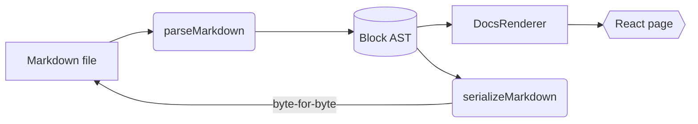


````md

````



The result pane is labelled **Pele** and carries two extras: an **Open in Playground** link that opens the diagram in Pele's online editor (for sources short enough to fit in a URL), and the time Pele took to draw it. Diagrams use the page's font and theme colours, and redraw nothing when the theme flips. A wide left-to-right chart in a narrow pane turns top-down instead of shrinking.

### Try it

The `Mermaid` component behind every mermaid fence, wired to a text box:



### A gallery

Pele understands most of Mermaid's diagram types. A selection, each as you'd write it:



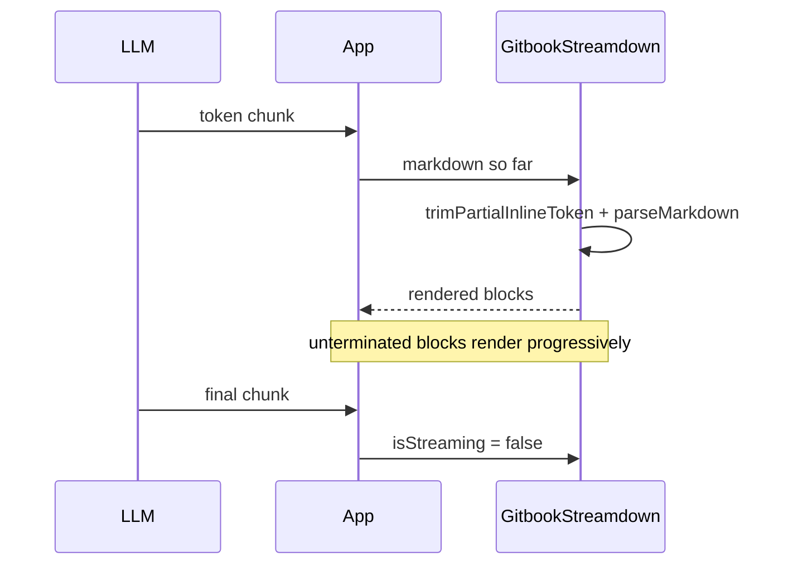


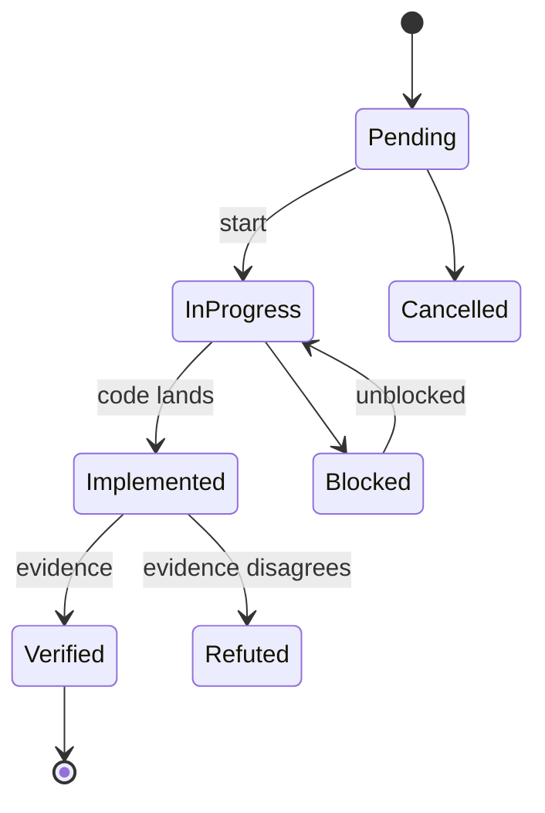


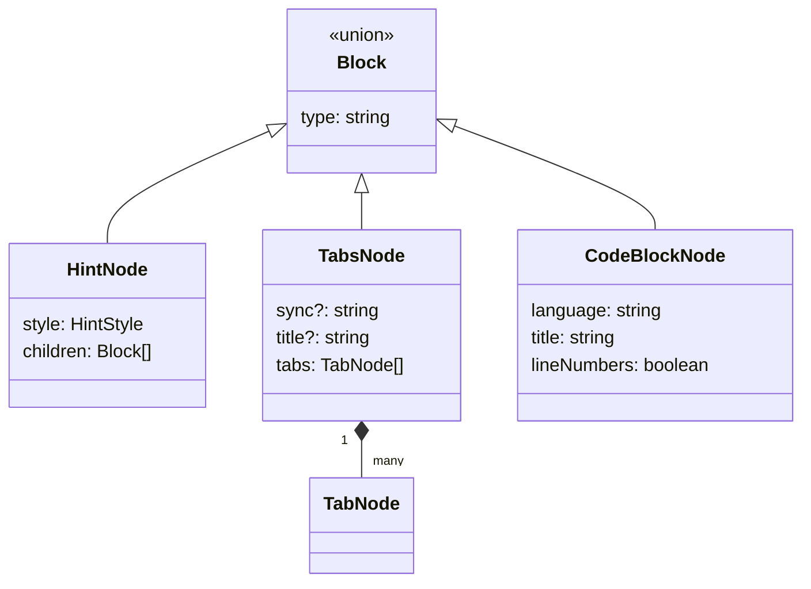


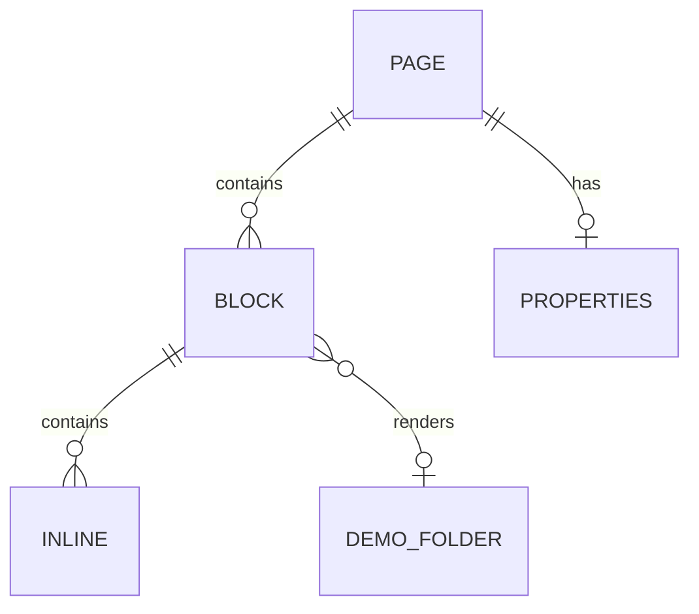


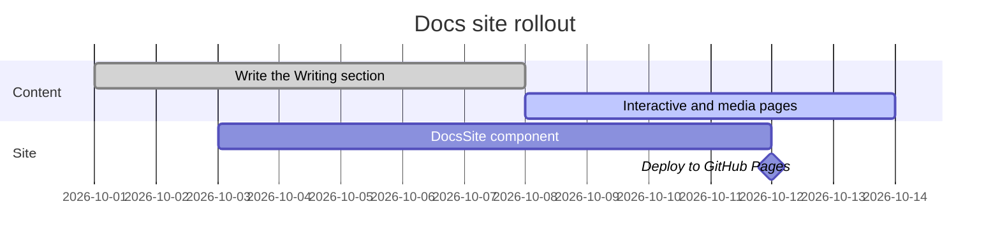


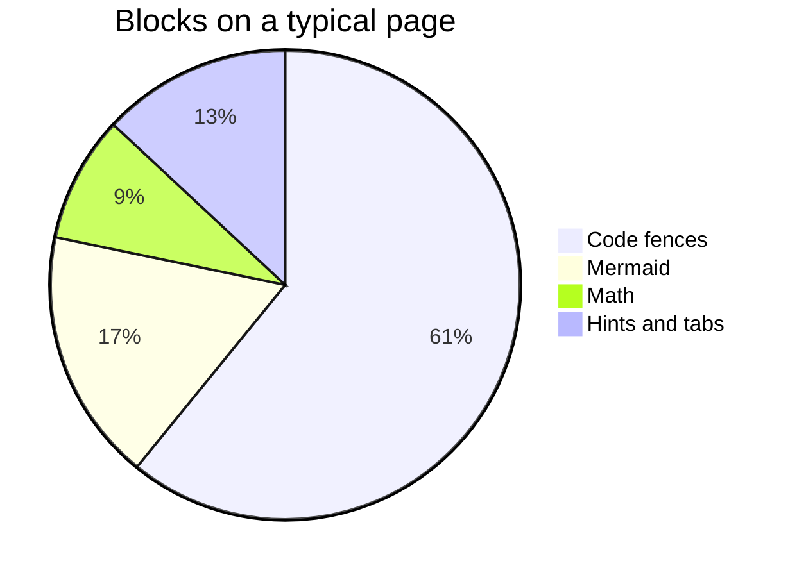


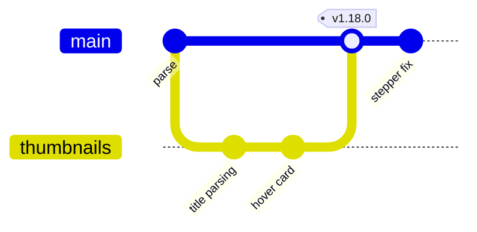


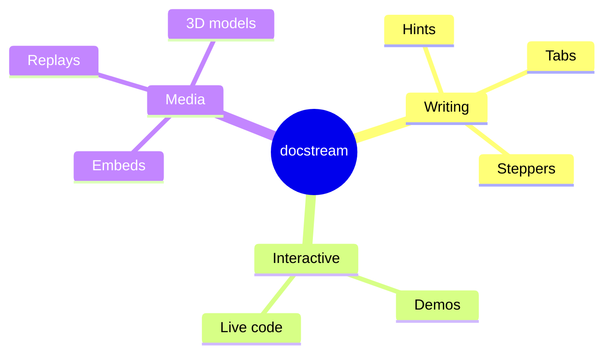


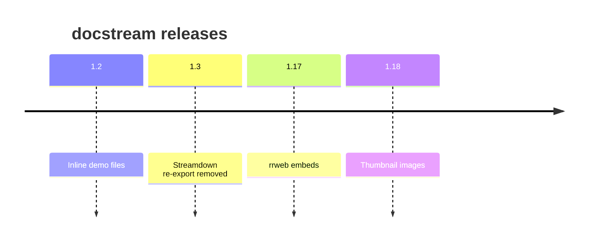


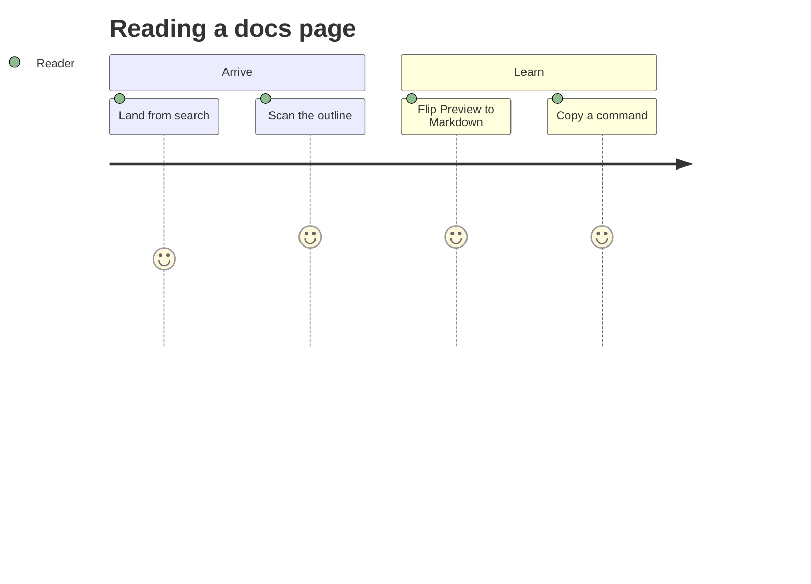


```mermaid
xychart-beta
  title "Render time by page size"
  x-axis [10, 50, 100, 200, 400]
  y-axis "ms" 0 --> 40
  line [1.2, 4.8, 9.1, 17.5, 33.0]
```


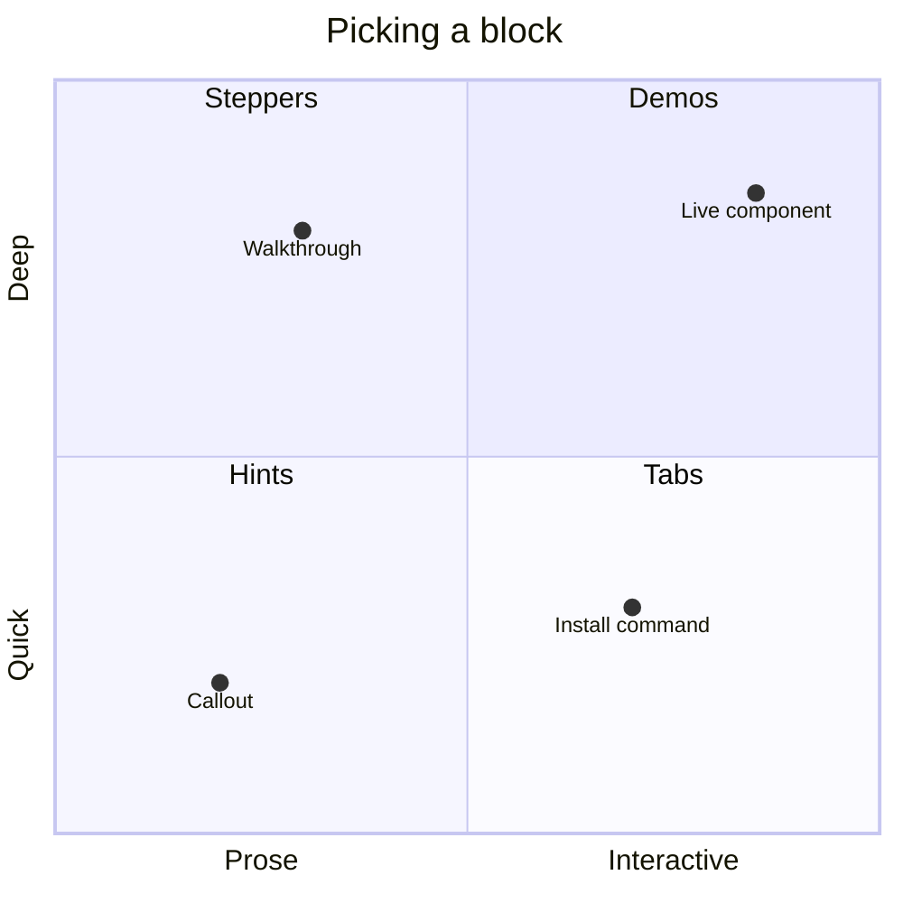


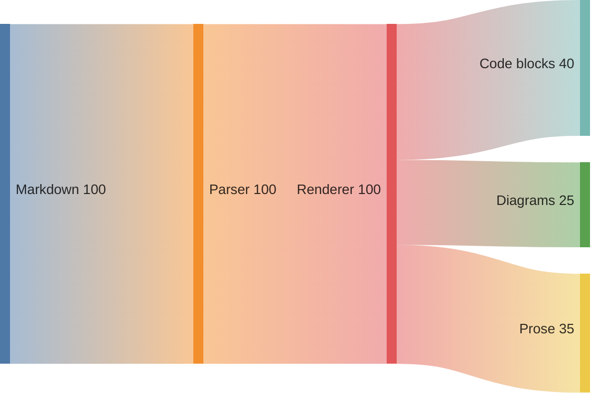



Beyond these, Pele draws requirement, C4, block, packet, kanban, architecture, radar, treemap and more — see [pele.run](https://pele.run) for the full list.

### Diagram edge cases

- The fence language must be exactly `mermaid`. Its source pane always shows the whole diagram; `collapsedCodeLines` / `expandedCodeLines` are accepted on mermaid fences for older documents and have no effect.
- A syntax error shows Pele's message in place of the drawing (as text — never as markup), and the source pane still shows what you wrote.
- A tab set whose tabs are all mermaid fences stays a normal tab set — each tab gets its own card — rather than [collapsing](02-callouts-and-tabs.md#code-only-tabs-collapse) into one code block.
- Very long sources don't fit in a URL, so their card has no **Open in Playground** link.

## Split cards

Math and diagrams share one layout, the **split card**. It is a size container: when the card is at least **640px** wide, source and result sit side by side; narrower — a phone, a column, a demo pane — the source stacks above the result. The breakpoint follows the card's own width, not the window's, so a diagram inside a [column](04-layout.md#columns) stacks even on a wide screen:



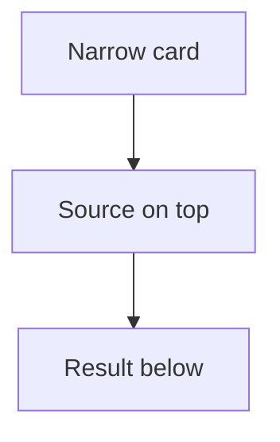


$$
c = \sqrt{a^2 + b^2}
$$



The card is exported as `SplitCard`, `SplitSource` and `SplitResult` — the same pieces work for any source-and-output pair of your own:

```tsx title="RegexCard.tsx"
import { SplitCard, SplitResult, SplitSource } from "@brett_lamy/docstream"

export function RegexCard({ pattern, sample }: { pattern: string; sample: string }) {
  const matches = sample.match(new RegExp(pattern, "g")) ?? []
  return (
    <SplitCard>
      <SplitSource label="RegExp" code={pattern} language="regex" />
      <SplitResult label={`${matches.length} matches`}>
        <pre>{matches.join("\n")}</pre>
      </SplitResult>
    </SplitCard>
  )
}
```

## Next


Changelogs — dated release notes with ``

