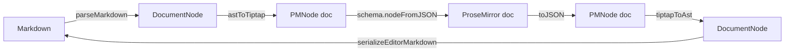

# Conversion

Everything `GitbookEditor` does with Markdown goes through a handful of pure functions. They are exported so you can do the same: convert on a server, validate stored editor JSON, build a custom `useEditor`, or wire Yjs.


The conversion functions live in `src/editor/convert.ts`. Import them from the root entry, or from `@brett_lamy/docstream-editor/convert`. The `/convert` entry imports only `@brett_lamy/docstream/gitbook` (no React, no Tiptap), so it runs in Node, workers and edge functions.


## The pipeline





## `astToTiptap`

```ts lineNumbers="false"
function astToTiptap(doc: DocumentNode): PMNode
```

Converts a docstream document into Tiptap JSON, ready for `useEditor({ content })` or `editor.commands.setContent()`. Frontmatter goes on the doc node's `properties` attribute. Each node's Markdown layout goes on its `md` attribute.

| docstream block | Editor node |
| --- | --- |
| `paragraph`, `heading`, `blockquote`, `divider` | `paragraph`, `heading`, `blockquote`, `horizontalRule` |
| `code` | `codeBlock` (`language`, `title`, `lineNumbers`, `live`, `entry`, …) |
| `list` | `bulletList` / `orderedList` / `taskList` with `listItem` / `taskItem` (`checked`, `state`) |
| `table` | `table` → `tableRow` → `tableHeader` / `tableCell` (`view`, `align` kept) |
| `hint` | `gbHint` (`style`) |
| `tabs` / `tab` | `gbTabs` / `gbTab` |
| `command` | `gbCommand` |
| `expandable` | `gbExpandable` |
| `stepper` / `step` | `gbStepper` / `gbStep` |
| `columns` / `column` | `gbColumns` / `gbColumn` |
| `embed` | `gbEmbed` (`url`, `title`, `poster`, `autoplay`, `loop`, `muted`, `controls`) |
| `content-ref` | `gbContentRef` |
| `source-ref` | `gbSourceRef` (`mount`, `path`, `exportName`, `kind`, `title`) |
| `demo` | `gbDemo` (every tag attribute, plus inline `files`) |
| `figure` | `gbFigure`, or a paragraph holding a `gbAttachment` chip when `src` is `attachment:<id>` |
| `math` | `gbMath` (`formula`) |
| `updates` / `update` | `gbUpdates` / `gbUpdate` (`date`) |
| `openapi-operation` | `gbOpenapi` |
| `definition` (`[label]: url`) | `gbDefinition` |
| `raw` (a tag docstream doesn't know) | `gbRaw`, kept verbatim |

| docstream inline | Editor node or mark |
| --- | --- |
| text with `bold` / `italic` / `strike` / `code` / `link` | `text` with those marks (plus `mdEscaped` for escapes) |
| `reference` (`@id`, `#id`, `$id`, `[^1]`) | `gbReference` (`kind`: `mention` / `tag` / `codebase` / `citation`) |
| `image` | `gbInlineImage`, or `gbAttachment` for `attachment:` URLs |
| an empty link `[](url)` | `gbEmptyLink` |

Containers that ProseMirror requires to hold blocks get one empty paragraph when the Markdown left them empty. An empty document becomes a single empty paragraph.

## `tiptapToAst`

```ts lineNumbers="false"
function tiptapToAst(doc: PMNode): DocumentNode
```

The inverse, from `editor.getJSON()` (or any Tiptap JSON for this schema) back to a docstream document, with frontmatter and layout. It also:

- drops empty paragraphs, which Markdown can't represent;
- gives a new list the other marker when it sits right after a list of the same kind, so saving and reopening doesn't merge the two;
- skips node types it doesn't know (your own extensions' nodes, unless you serialize them yourself).


Footnote definitions aren't in the JSON. Copy them from the parsed source: `back.citations = parseMarkdown(md).citations`. `GitbookEditor` does this for you. It also merges in definitions from pasted Markdown.


## `serializeEditorMarkdown`

```ts lineNumbers="false"
function serializeEditorMarkdown(doc: DocumentNode): string
```

docstream's `serializeMarkdown`, with attachment chips that have no recorded syntax written as ``. A name with an unbalanced `]` keeps docstream's `` form. Use this, not `serializeMarkdown`, for anything that came out of the editor.

```ts title="round-trip.ts"
import { parseMarkdown } from "@brett_lamy/docstream/gitbook"
import { astToTiptap, serializeEditorMarkdown, tiptapToAst } from "@brett_lamy/docstream-editor/convert"

export function roundTrip(markdown: string): string {
  const source = parseMarkdown(markdown)
  const back = tiptapToAst(astToTiptap(source))
  if (source.citations?.length) back.citations = source.citations
  return serializeEditorMarkdown(back) // === markdown
}
```

## `markdownPasteContent`

```ts lineNumbers="false"
function markdownPasteContent(text: string): { content: PMNode[]; citations?: CitationDef[] } | null
```

The parser behind the `markdownPaste` prop. It returns editor content for clipboard text that has structure: any block other than a paragraph, a `` anywhere, or footnote definitions. It returns `null` for empty text and plain prose, and then the editor pastes the text as usual. Use it in your own `handlePaste`, or to preview what a paste will do:



## `embedBlockFor`

```ts lineNumbers="false"
function embedBlockFor(url: string): PMNode
```

The block a dropped, picked or uploaded URL becomes (exported from the root and `/editor` entries):

- an image URL (`.png`, `.jpg` / `.jpeg`, `.gif`, `.webp`, `.avif`, `.svg`, `.bmp`, `.ico`, with or without a query) becomes a `gbFigure`, with `alt` taken from the decoded file name and written as a Markdown image, ``;
- anything else becomes a `gbEmbed`, which docstream renders as a video, YouTube player, replay, 3D model, Strudel player or link card according to the URL.

Insert the result with `editor.commands.insertContent(embedBlockFor(url))`. The demo above shows its output under the **embedBlockFor** variant.

## `getGitbookSchema`

```ts lineNumbers="false"
function getGitbookSchema(): Schema
```

The ProseMirror schema `GitbookEditor` uses, built from `createGitbookExtensions({ slashMenu: false })`. Two uses:

- **Validate stored JSON.** `getGitbookSchema().nodeFromJSON(json).check()` throws on content the editor would reject. The round-trip demo above runs every sample through it.
- **Yjs.** y-prosemirror converts between a `Y.XmlFragment` and ProseMirror with this exact schema (`yXmlFragmentToProseMirrorRootNode(fragment, getGitbookSchema())`), so you can turn a shared document into Markdown on a server: `serializeEditorMarkdown(tiptapToAst(node.toJSON()))`.

## Node helpers (`/convert` only)

Three more functions are exported from `@brett_lamy/docstream-editor/convert` (not from the root). They're the converters the node views use to draw the read-only preview of a block:

| Function | Converts |
| --- | --- |
| `pmToDemo(attrs)` | `gbDemo` attributes → docstream `DemoNode` |
| `pmDemoFiles(value)` | A `gbDemo` `files` attribute → `DemoInlineFile[]`, dropping malformed entries |
| `pmToCommand(attrs)` | `gbCommand` attributes → docstream `CommandNode` |

## `PMNode`

```ts title="convert.ts"
interface PMNode {
  type: string
  attrs?: Record<string, unknown>
  content?: PMNode[]
  marks?: Array<{ type: string; attrs?: Record<string, unknown> }>
  text?: string
}
```

The loosely typed Tiptap / ProseMirror JSON shape every helper takes and returns. It is the same shape as `editor.getJSON()`.

## See also


With docstream: what rides on hidden attributes, and the version rule



Extensions: build your own useEditor from the same pieces

