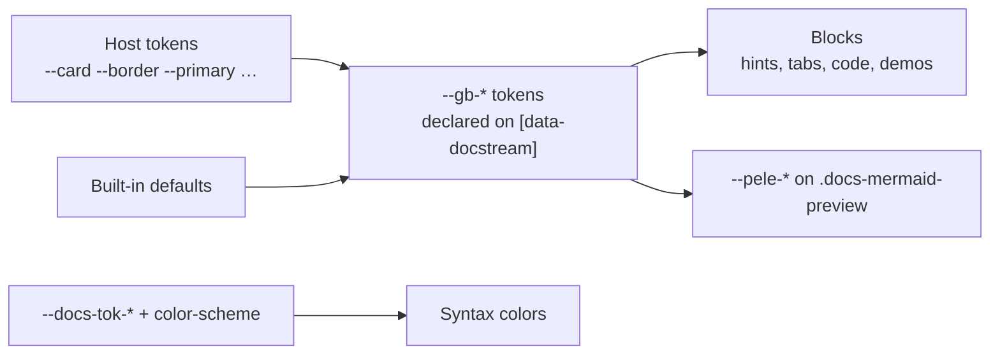

# Theming

`@brett_lamy/docstream/styles.css` is driven entirely by CSS custom properties. Every `--gb-*` token is declared on `[data-docstream]` and `.docs-article` as `var(--host-token, default)`: it reads a shadcn-style host token when your app defines one and falls back to a neutral light-zinc default when it doesn't. So rendering looks right with **zero setup**, and follows a shadcn/Tailwind theme automatically.



## Where tokens live

`MarkdownContent` and `GitbookStreamdown` render a `div[data-docstream]`; `DocsRenderer` renders `article.docs-article`. Both selectors declare the full token set, so every block inside — hints, tabs, code, demos, the replay player — reads the same values.




Because docstream **re-declares** `--gb-*` on `[data-docstream]`, a `--gb-*` value set on an *ancestor* is overridden. Set host tokens (`--card`, `--border`, …) on an ancestor, or set `--gb-*` on the `[data-docstream]` element itself (e.g. through `className`). The demo above shows both.


## Token reference

### Surfaces and text

These read a shadcn host token first.

| Token | Reads host token | Default | Drives |
| --- | --- | --- | --- |
| `--gb-panel` | `--card` | `#ffffff` | Cards, code headers, tab sets, demo bodies, menus |
| `--gb-panel-foreground` | `--card-foreground` | `#18181b` | Text on panels, diagram strokes |
| `--gb-muted` | `--muted` | `#f4f4f5` | Code headers, tag chips, file lists |
| `--gb-muted-foreground` | `--muted-foreground` | `#71717a` | Secondary text, line numbers, captions, labels |
| `--gb-border` | `--border` | `#e4e4e7` | Every hairline: cards, code, tables, hints, demos |
| `--gb-accent` | `--accent` | `#f4f4f5` | Hover background of cards, content refs, chips |
| `--gb-accent-foreground` | `--accent-foreground` | `#18181b` | Hover text of the same |
| `--gb-primary` | `--primary` | `#4f46e5` | Active tabs and pills, focus rings, current items |
| `--gb-primary-foreground` | `--primary-foreground` | `#fafafa` | Text on primary (the Strudel play button) |
| `--gb-code-bg` | — | `rgba(128, 128, 128, 0.13)` | Code block and demo-source backgrounds |
| `--gb-code-fg` | `--foreground` | `#18181b` | Code text |

Text color itself is `color: var(--foreground, #18181b)` on the docstream root. docstream never sets a page background — the document sits on yours.

### Controls and chrome

Plain values (no host token), translucent so they sit on light and dark hosts alike.

| Token | Default | Drives |
| --- | --- | --- |
| `--gb-radius` | `12px` | Source-preview cards |
| `--gb-stage` | `rgba(128, 128, 128, 0.09)` | The demo viewer's stage |
| `--gb-stage-dot` | `rgba(128, 128, 128, 0.28)` | The stage's dot grid and resize handles |
| `--gb-pill` | `var(--gb-panel)` | The sliding indicator of pill tabs |
| `--gb-pill-track` | `rgba(128, 128, 128, 0.12)` | The pill-tab track, demo status pill |
| `--gb-pill-shadow` | `0 1px 2px rgba(15,15,35,.14), 0 0 0 .5px rgba(15,15,35,.1)` | Pill indicator and selected-file shadow |
| `--gb-hover` | `rgba(128, 128, 128, 0.12)` | Icon-button and menu-item hover |
| `--gb-menu-shadow` | `0 14px 34px -10px rgba(15,15,35,.28), 0 2px 6px rgba(15,15,35,.08)` | Page-actions and breadcrumb menus |
| `--gb-term-bg` | `rgba(128, 128, 128, 0.2)` | The terminal glyph in command boxes |
| `--gb-term-fg` | `var(--gb-muted-foreground)` | The terminal glyph's color |

The terminal glyph has its own pair so a host that sets panel colors to `currentColor` still gets a visible glyph.

### Semantic palette

Solid colors plus precomputed tints — plain `rgba()`/hex, no `color-mix()` or `oklch()`, so the theme renders in older Chromium forks too. The same palette is used by `@brett_lamy/docstream-editor`. Besides hints, these color citation badges and mentions (`info`), copy ticks (`success`) and the OpenAPI method/status badges.

| Token | Default | Border tint | Background tint |
| --- | --- | --- | --- |
| `--gb-info` | `#3b82f6` | `--gb-info-border` `rgba(59,130,246,.45)` | `--gb-info-bg` `rgba(59,130,246,.1)` |
| `--gb-success` | `#22c55e` | `--gb-success-border` `rgba(34,197,94,.45)` | `--gb-success-bg` `rgba(34,197,94,.1)` |
| `--gb-warning` | `#f59e0b` | `--gb-warning-border` `rgba(245,158,11,.5)` | `--gb-warning-bg` `rgba(245,158,11,.12)` |
| `--gb-danger` | `#ef4444` | `--gb-danger-border` `rgba(239,68,68,.45)` | `--gb-danger-bg` `rgba(239,68,68,.1)` |

<details>
<summary>Undeclared tokens docstream reads if you set them</summary>

| Token | Fallback | Used by |
| --- | --- | --- |
| `--gb-mono` | `ui-monospace, SFMono-Regular, Menlo, monospace` | Thumbnail badges |
| `--gb-danger-foreground` | `#b42318` | Source-preview error text |
| `--docs-thumb-width` | `168px` | Thumbnail images |
| `--docs-thumb-card-width` | `720px` | The thumbnail hover card |

</details>

## Mapping a shadcn theme

If your app already defines shadcn tokens on `:root`, there is nothing to do — docstream picks them up everywhere. These are the host tokens the stylesheet reads:

| Host token | Feeds |
| --- | --- |
| `--background` | Demo preview frames and the fullscreen dialog (falling back to `--gb-panel`), the replay player |
| `--foreground` | Document text, `--gb-code-fg` |
| `--card`, `--card-foreground` | `--gb-panel`, `--gb-panel-foreground` |
| `--muted`, `--muted-foreground` | `--gb-muted`, `--gb-muted-foreground` |
| `--border` | `--gb-border` |
| `--accent`, `--accent-foreground` | `--gb-accent`, `--gb-accent-foreground` |
| `--primary`, `--primary-foreground` | `--gb-primary`, `--gb-primary-foreground` |
| `--popover`, `--popover-foreground` | The task-state menu |
| `--ring`, `--destructive`, `--success`, `--warning`, `--tertiary-foreground` | The replay player |

Tokens must hold **complete colors** (`#16161d`, `rgb(…)`, `oklch(…)`), because docstream uses them directly as `var(--card)`. If your theme stores bare HSL channels (`--card: 0 0% 100%`, the shadcn v0 convention), map them once on the docstream root:

```css title="docstream-theme.css"
[data-docstream],
.docs-article {
  --gb-panel: hsl(var(--card));
  --gb-panel-foreground: hsl(var(--card-foreground));
  --gb-muted: hsl(var(--muted));
  --gb-muted-foreground: hsl(var(--muted-foreground));
  --gb-border: hsl(var(--border));
  --gb-accent: hsl(var(--accent));
  --gb-accent-foreground: hsl(var(--accent-foreground));
  --gb-primary: hsl(var(--primary));
  --gb-primary-foreground: hsl(var(--primary-foreground));
  --gb-code-fg: hsl(var(--foreground));
  color: hsl(var(--foreground));
}
```

Load it after `styles.css` so it wins on equal specificity.

## Overriding



**Globally — set host tokens.** The shadcn way; everything follows.

```css
:root {
  --card: #0b0b10;
  --border: #26263a;
  --muted: #17171f;
  --muted-foreground: #9a9ab0;
  --primary: #8b8bf0;
}
```


**Per document — set `--gb-*` on the element.** For tokens with no host equivalent.

```tsx
<MarkdownContent className="brand-docs" markdown={md} />
```

```css
.brand-docs[data-docstream] {
  --gb-info: #0d9488;
  --gb-info-bg: rgba(13, 148, 136, 0.08);
  --gb-info-border: rgba(13, 148, 136, 0.5);
}
```



The extra attribute selector (`.brand-docs[data-docstream]`) out-specifies the stylesheet's `[data-docstream]`, so the override wins regardless of load order. For `DocsRenderer`, target `.docs-article` instead.

## Dark mode

docstream has no dark mode of its own to switch: it follows your tokens. Define a dark set of host tokens, and set `color-scheme: dark` so syntax highlighting switches palette too. This is exactly how this site does it:

```css title="site.css"
:root {
  color-scheme: light;
  --background: #ffffff;
  --foreground: #16161d;
  --card: #ffffff;
  --border: #e4e4ea;
  --primary: #5b5bd6;
  /* … */
}

:root[data-theme="dark"] {
  color-scheme: dark;
  --background: #0e0e12;
  --foreground: #ececf1;
  --card: #16161b;
  --border: #2a2a34;
  --primary: #8b8bf0;
  /* … */
}

/* Shadows have no host token: darken them for a dark surface. */
:root[data-theme="dark"] [data-docstream] {
  --gb-pill: #2a2a33;
  --gb-pill-shadow: 0 1px 2px rgba(0, 0, 0, 0.5), 0 0 0 0.5px rgba(255, 255, 255, 0.1);
  --gb-menu-shadow: 0 14px 34px -10px rgba(0, 0, 0, 0.6), 0 2px 6px rgba(0, 0, 0, 0.3);
}
```

`color-scheme` also works on any container, so a dark card inside a light page gets dark code colors (the **Host tokens** variant of the demo does this).

## Syntax highlighting

Code is tokenized by `gpu-lexer` into `.docs-tok-*` spans. Each color is a custom property whose default is a `light-dark()` pair — a same-hue AA color on light schemes, Palenight on dark ones:

| Token class | Custom property | Light | Dark |
| --- | --- | --- | --- |
| keyword | `--docs-tok-keyword` | `#8839C4` | `#C792EA` |
| type | `--docs-tok-type` | `#A15C00` | `#FFCB6B` |
| function | `--docs-tok-function` | `#2F5BD3` | `#82AAFF` |
| string | `--docs-tok-string` | `#23803A` | `#A5D6A7` |
| number | `--docs-tok-number` | `#C2410C` | `#F78C6C` |
| constant | `--docs-tok-constant` | `#C8283F` | `#F07178` |
| operator | `--docs-tok-operator` | `#0B7285` | `#89DDFF` |
| comment | `--docs-tok-comment` (italic) | `#6E6E7A` | `#8A8A98` |

Set any of them to retheme; a single value applies in both schemes.

<details>
<summary>What about the <code>--chart-1…4</code> rules?</summary>

The stylesheet still colors highlight.js classes (`.hljs-keyword`, `.hljs-string`, …) from `--chart-1` to `--chart-4`, for hosts that render hljs-highlighted HTML inside a document. docstream's own code blocks don't emit those classes — they use the `--docs-tok-*` palette above.

</details>

## Diagrams (Pele)

Mermaid fences are drawn by Pele, which reads `--pele-*` variables. docstream maps them from its own tokens on `.docs-mermaid-preview`, so a theme switch recolors diagrams without redrawing them:

| Pele variable | Value |
| --- | --- |
| `--pele-bg` | `transparent` |
| `--pele-fg` | `var(--gb-panel-foreground, currentColor)` |
| `--pele-muted` | `var(--gb-muted-foreground)` |
| `--pele-line` | `var(--gb-muted-foreground)` |
| `--pele-surface` | `var(--gb-hover, rgba(128, 128, 128, 0.12))` |
| `--pele-surface-alt` | `var(--gb-code-bg)` |
| `--pele-border` | `var(--gb-border)` |
| `--pele-accent` | `var(--gb-primary)` |
| `--pele-error` | `var(--gb-danger, #ef4444)` |
| `--pele-radius` | `6px` |

Override one by setting it on `.docs-mermaid-preview` (with higher specificity, e.g. `.brand-docs .docs-mermaid-preview`). Pele measures text in the diagram's own font; set `--pele-font` there to use a different one.

## Replay player

The replay player's CSS sits in the `docstream.replay` cascade layer under zero-specificity `:where()` selectors, so your own rules and utility classes override it. If your utilities layer is declared before this stylesheet, put `@layer docstream.replay;` ahead of it. Its parts are addressable as `[data-slot="replay-preview"]` (with `data-state` `loading | paused | playing`), `-bar`, `-stage`, `-poster`, `-pointer`, `-controls`, `-scrubber` and `-markers`. See [Replays](../05-media/02-replays.md).

## Stable class names

Beyond tokens, every block has a stable class for targeted overrides: `docs-code`, `docs-tabs`, `docs-hint` (+ `docs-hint-info|success|warning|danger`), `docs-table`, `docs-cards` / `docs-card`, `docs-stepper`, `docs-columns`, `docs-figure`, `docs-content-ref`, `docs-mermaid-preview`, `docs-math-card`, `docs-demo`, `oas` (OpenAPI).
