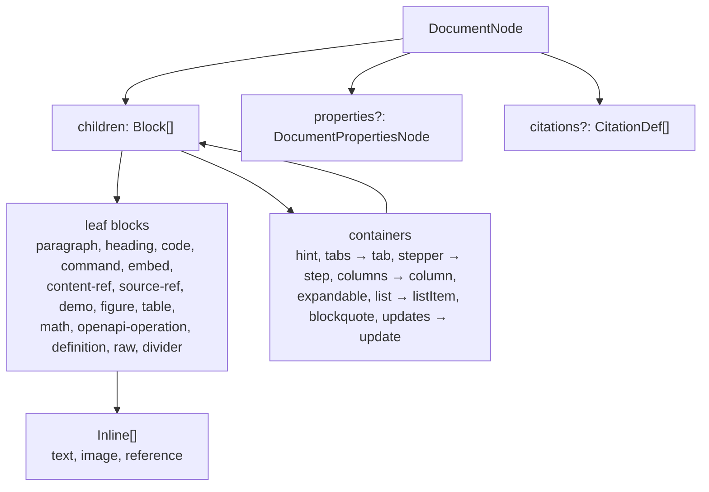

# AST reference

The AST in `src/gitbook/ast.ts` is the single source of truth shared by the parser, the serializer, the docs renderer and the editor's converters. Every type is exported (type-only) from the package root and from `@brett_lamy/docstream/gitbook`.

```ts lineNumbers="false"
import type { DocumentNode, Block, Inline } from "@brett_lamy/docstream/gitbook"
```


Nodes are plain JSON. Fields fall in two groups: **semantic** fields say what the document means and are what renderers read; **layout** fields record how the source spelled it, appear only where the source differs from the serializer's default, and exist so pages round-trip byte-for-byte. Build nodes with just the semantic fields and they serialize canonically. The [parser explorer](02-parser-api.md) shows both on live input.




## Document

### `DocumentNode`

| Field | Type | Meaning |
| --- | --- | --- |
| `type` | `"doc"` | |
| `children` | `Block[]` | The body. |
| `properties?` | `DocumentPropertiesNode` | YAML frontmatter, kept separate from the body. |
| `citations?` | `CitationDef[]` | Footnote citation definitions, in definition order. |
| `citationsGap?` | `number` | Layout: blank lines before the trailing footnote definitions (default 1). |
| `lineEnding?` | `"\r\n"` | Layout: the source used CRLF throughout. |
| `end?` | `string` | Layout: what followed the last line, when more than one newline. |

### `DocumentPropertiesNode`

| Field | Type | Meaning |
| --- | --- | --- |
| `yaml` | `string` | YAML between the delimiters. Comments, key order and quoting survive edits. |
| `opening?` | `string` | Opening delimiter as written (may include a BOM). Default `---`. |
| `closing?` | `string` | Closing delimiter as written (`---` or `...`). Default `---`. |

Read and edit it with `readDocumentProperties` / `setDocumentProperty` / `removeDocumentProperty`.

### `CitationDef`

`{ id: string; url: string; label?: string }` — from `[^id]: url "Label"`.

## Inline nodes

`Inline` is `TextNode | InlineImageNode | ReferenceNode`. All three extend `InlineMarks`, so emphasis and links can span text, chips and images alike (`**ask @brett**`, `[](url)`).

### `InlineMarks`

| Field | Type | Meaning |
| --- | --- | --- |
| `bold?` / `italic?` / `strike?` | `boolean` | Formatting. |
| `link?` | `string` | Link target around this inline. |
| `linkTitle?` | `string` | `[x](url "title")`'s title. |
| `linkRef?` | `string` | Reference label of `[text][ref]` (or the text, for collapsed/shortcut forms). |
| `linkTag?` / `linkTagEnd?` | `string` | Opening / closing tag of an inline HTML link as written. |
| `linkInner?` | `true` | Layout: the link sits inside the emphasis (`**[x](u)**`) rather than around it. |
| `linkId?` | `number` | Keeps two adjacent links to the same URL (`[a](u)[b](u)`) distinct. |
| `delims?` | `InlineDelimiter[]` | Layout: how the source spelled this inline's formatting, outermost → innermost. |

`InlineDelimiter` is an `EmphasisDelimiter` (`"**" | "__" | "*" | "_" | "~~"`) or a `LinkForm` (`"link"` `[x](u)`, `"<>"` `<u>`, `"url"` bare autolink, `"ref"` `[x][l]`, `"collapsed"` `[x][]`, `"shortcut"` `[x]`, `"html"` `<a href>`). `delims` is only a hint: the boolean marks and `link` stay authoritative.

### `TextNode`

| Field | Type | Meaning |
| --- | --- | --- |
| `type` | `"text"` | |
| `text` | `string` | The literal characters (escapes resolved). |
| `code?` | `boolean` | A code span. |
| `escaped?` | `true` | Layout: every character was backslash-escaped in the source. |
| `barePipes?` | `number[]` | Layout: in a table-cell code span, offsets of `\|` written unescaped. |
| `ticks?` | `number` | Layout: a code span's backtick count, when longer than needed. |

### `InlineImageNode`

| Field | Type | Meaning |
| --- | --- | --- |
| `type` | `"image"` | |
| `src` | `string` | Image URL. |
| `alt?` / `title?` | `string` | Alt text; ``'s title. A title starting with `thumbnail` makes it a [thumbnail](04-components.md#imagethumbnail). |
| `width?` / `height?` | `string` | From HTML attributes. |
| `syntax?` | `"markdown"` | Written as ``. Absent: HTML `` (GitHub badge style). |
| `srcForm?` / `srcRef?` | `"ref" \| "collapsed" \| "shortcut"` / `string` | A Markdown image whose source comes from a definition. |
| `html?` | `string` | Layout: the HTML as written, reused while it still says the same. |

### `ReferenceNode`

| Field | Type | Meaning |
| --- | --- | --- |
| `type` | `"reference"` | |
| `kind` | `"mention" \| "tag" \| "codebase" \| "citation"` | `@id`, `#id`, `$id` (ids may contain `/`), or `[^id]`. |
| `id` | `string` | Without the sigil. |
| `url?` / `label?` | `string` | A citation's target and label, resolved from its definition at parse time. |

The inherited `link` is a link *around* the chip (`[@brett](url)`); `url` is the citation's own target. Chips are recognized only at a word boundary, so `brett@replay.io` and `C#` stay text.

## Block nodes

`Block` is the union of the 23 block types below. Every block extends `BlockSpacing` (layout: `gap?` blank lines before it, `blanks?` those lines as written).

### Text

| Node | Fields | Markdown |
| --- | --- | --- |
| `ParagraphNode` | `type: "paragraph"`, `children: Inline[]`, layout `indent?` | Text lines |
| `HeadingNode` | `type: "heading"`, `level: 1–6`, `children: Inline[]`, layout `setext?` (the `===`/`---` underline) | `# …` or setext |
| `BlockquoteNode` | `type: "blockquote"`, `children: Block[]`, layout `markers?` | `> …` |
| `DividerNode` | `type: "divider"`, layout `marker?` (`***`, `___`, …) | `---` |
| `DefinitionNode` | `type: "definition"`, `label`, `url`, `title?`, layout `raw?` | `[label]: url "title"` where written |
| `RawNode` | `type: "raw"`, `markdown: string` | An unknown `` line — renders nothing, serialized verbatim |

### Code and commands

**`CodeBlockNode`** — a fenced (or indented) code block.

| Field | Type | Meaning |
| --- | --- | --- |
| `type` | `"code"` | |
| `language` | `string \| null` | Info-string language. `mermaid` draws a diagram, `strudel` a music player. |
| `title` | `string \| null` | `title="file.ts"` — a header bar with the file name. |
| `code` | `string` | The content. |
| `lineNumbers` | `boolean` | Default on for titled fences, off for untitled; `lineNumbers="true"` or `"false"` overrides. |
| `live?` | `boolean` | `live="true"`: run a jsx/tsx/react fence through the host's `liveRenderer`. |
| `entry?` | `string \| null` | Virtual entry path for a live fence (default `/src/main.jsx`). |
| `collapsedCodeLines?` / `expandedCodeLines?` | `number` | Source lines visible collapsed / before scrolling. |
| `lineNumbersExplicit?` | `boolean` | Layout: the source wrote the attribute even though it matched the default. |
| `fence?` / `closingFence?` / `info?` | `string` | Layout: fence and info string as written. |
| `indented?` | `true` | A four-space indented block. |
| `raw?` | `string` | Layout: the legacy `` wrapper as written. |

**`CommandNode`** — `npm install x`.

| Field | Type | Meaning |
| --- | --- | --- |
| `type` | `"command"` | |
| `command` | `string` | The npm / npx command (may span lines). |
| `overrides?` | `Partial<Record<"pnpm" \| "yarn" \| "bun", string>>` | Verbatim commands for other managers (`pnpm="…"`). |
| `sync?` | `string` | Sync key; omitted means `"pm"`. |

### Containers

Containers extend `ContainerSpacing` (layout `gapEnd?`: blank lines before the closing line); tag-based ones also extend `TagLines` (layout `opening?` / `closing?`: the tag lines as written).

| Node | Fields | Markdown |
| --- | --- | --- |
| `HintNode` | `type: "hint"`, `style: HintStyle`, `children: Block[]` | `` — unknown styles parse as `info` |
| `TabsNode` | `type: "tabs"`, `tabs: TabNode[]`, `sync?`, `title?`, `level?: 2 \| 3 \| 4` | `` |
| `TabNode` | `type: "tab"`, `title: string` (default `"Tab"`), `children: Block[]` | `` |
| `StepperNode` | `type: "stepper"`, `steps: StepNode[]` | `` |
| `StepNode` | `type: "step"`, `title: string`, `children: Block[]`, layout `heading?` | ``; the first heading is the title |
| `ColumnsNode` | `type: "columns"`, `columns: ColumnNode[]` | `` |
| `ColumnNode` | `type: "column"`, `children: Block[]` | `` |
| `ExpandableNode` | `type: "expandable"`, `summary: string`, `children: Block[]`, layout `opening?`, `closing?` | `<details><summary>…</summary>` |
| `UpdatesNode` | `type: "updates"`, `format: string \| null`, `updates: UpdateNode[]` | `` |
| `UpdateNode` | `type: "update"`, `date: string`, `children: Block[]` | `` |

`HintStyle` is `"info" | "success" | "warning" | "danger"`. `TabNode`, `StepNode`, `ColumnNode`, `UpdateNode` and `ListItemNode` are child-only shapes: they appear inside their parents, never in `Block[]` directly.

### Lists

**`ListNode`**

| Field | Type | Meaning |
| --- | --- | --- |
| `type` | `"list"` | |
| `ordered` | `boolean` | |
| `task` | `boolean` | A task list. |
| `items` | `ListItemNode[]` | |
| `start?` | `number` | First number of an ordered list (default 1). |
| `bullet?` / `delimiter?` / `indent?` | `"*" \| "+"` / `")"` / `string` | Layout: marker style and indent as written. |

**`ListItemNode`**

| Field | Type | Meaning |
| --- | --- | --- |
| `type` | `"listItem"` | |
| `children` | `Block[]` | |
| `checked?` | `boolean` | Present only in task lists. |
| `state?` | `TaskState` | Extended task state (`[~]`, `[?]`, `[b]`, `[d]`, `[!]`, `[-]`); omitted for plain `[ ]` / `[x]`. |
| `marker?` / `pad?` / `indent?` / `checkMark?` | `string` / `number` / `number` / `"X"` | Layout. |

`TaskState` is `"pending" | "in-progress" | "implemented" | "blocked" | "parked" | "refuted" | "verified" | "cancelled"`.

### Media and links

| Node | Fields | Markdown |
| --- | --- | --- |
| `FigureNode` | `type: "figure"`, `src`, `alt`, `caption` (strings), `title?`, layout `raw?` | A solo `` line, a solo ``, or `<figure>…<figcaption>` |
| `EmbedNode` | `type: "embed"`, `url`, `title?`, `poster?`, `autoplay?`, `loop?`, `muted?`, `controls?`, layout `raw?` | `` (an `` is tolerated) |
| `ContentRefNode` | `type: "content-ref"`, `url: string`, `children: Inline[]`, layout `raw?` | `…`, and GitBook `` |
| `TableNode` | `type: "table"`, `header: Inline[][]`, `rows: Inline[][][]`, `view?` (`"cards"`), `align?`, `html?: true`, layout `delimiterRow?`, `raw?`, `rawRows?` | GFM pipe table or HTML `<table>` (`data-view="cards"` → card grid) |
| `MathNode` | `type: "math"`, `formula: string`, layout `raw?` | `$$ … $$` |
| `OpenApiOperationNode` | `type: "openapi-operation"`, `spec`, `path`, `method`, `specUrl`, `label` (strings), layout `raw?` | `[label](specUrl)` (`` also accepted) |

`align` is per column: `"left" | "center" | "right" | null`.

### Source references and demos

**`SourceRefNode`** — renders an export of a real file through the host's `sourceRenderer`.

| Field | Type | Meaning |
| --- | --- | --- |
| `type` | `"source-ref"` | |
| `mount` | `string` | Mount name from the Vite plugin (default `"source"`). |
| `path` | `string` | POSIX path inside the mount (`path=`, or `src=`). |
| `exportName` | `string` | `export=`; defaults to `default` for components, `Primary` for stories. |
| `kind` | `"component" \| "story"` | `kind="story"`, or the `` tag. |
| `title?` | `string` | |
| `raw?` | `string` | Layout: the tag as written (``, an end tag). |

Written ``, `` or ``.

**`DemoNode`** — ``, optionally carrying its files inline.

| Field | Type | Meaning |
| --- | --- | --- |
| `type` | `"demo"` | |
| `src` | `string` | Folder id for the host's `DemoResolver`. |
| `title?` / `description?` | `string` | Header text. |
| `height?` | `string` | Kept verbatim (`"420"`, `"60vh"`, `"auto"`). |
| `layout?` | `"auto" \| "single" \| "multi"` | |
| `variants?` | `DemoVariantOption[]` | `{ id, label }` from `variants="id:Label,…"`. |
| `viewport?` | `"desktop" \| "tablet" \| "phone"` | Initial viewport. |
| `entry?` | `string` | Entry among the inline files (default: the first). |
| `status?` / `bleed?` / `className?` / `surface?` / `variantsWidth?` | | Look attributes; override `meta.json` field by field. |
| `files?` | `DemoInlineFile[]` | `{ path, content, language? }` — one per titled fence, in order. |
| `open?` | `true` | Set while streaming before `` arrives: show code, don't run. Never serialized. |
| `raw?` | `string` | Layout. |

## Constructing nodes

There are no node constructors in the public API — nodes are object literals, typed by the exported interfaces:

```ts title="build.ts"
import { serializeMarkdown, type DocumentNode } from "@brett_lamy/docstream/gitbook"

const doc: DocumentNode = {
  type: "doc",
  children: [
    { type: "heading", level: 2, children: [{ type: "text", text: "Status" }] },
    {
      type: "hint",
      style: "success",
      children: [{ type: "paragraph", children: [{ type: "text", text: "All systems go.", bold: true }] }],
    },
    { type: "command", command: "npm install @brett_lamy/docstream" },
  ],
}

serializeMarkdown(doc)
// ## Status
//
// 
// **All systems go.**
// 
//
// npm install @brett_lamy/docstream
```
