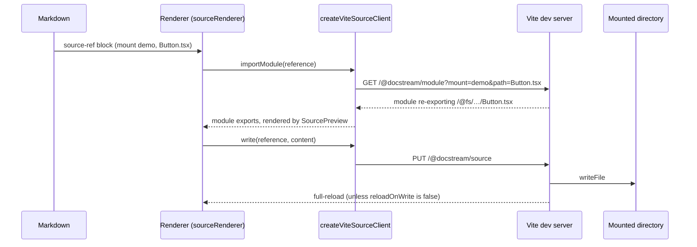

# Vite plugin

`docstreamSources` (from `@brett_lamy/docstream/vite`) mounts real directories of your repo behind a few endpoints on the Vite dev server. A `` block in Markdown then renders an export from one of those files, an editor can write the file back to disk, and a page can upload new files (a dropped `.rrweb` recording, say) into a mount. The files stay the authority; Markdown only stores which export to show.


`/vite` is a Node-only entry. Import it from `vite.config.ts`, never from browser code. The browser side is `createViteSourceClient` from the root or `@brett_lamy/docstream/source`.




## Setup



### Mount directories

```ts title="vite.config.ts"
import { defineConfig } from "vite"
import react from "@vitejs/plugin-react"
import { docstreamSources } from "@brett_lamy/docstream/vite"

export default defineConfig({
  plugins: [
    react(),
    docstreamSources({
      mounts: [
        { name: "demo", root: "src/examples" },                     // read + write
        { name: "docs", root: "docs", reloadOnWrite: false },        // editor autosaves Markdown
        { name: "vendor", root: "node_modules/@acme/ui/src", writable: false },
      ],
    }),
  ],
})
```



### Create a client and a source renderer

Use the live client in development and a bundled, read-only one in production builds, where the dev-server endpoints don't exist:

```tsx title="sources.tsx"
import {
  SourcePreview,
  createBundledSourceClient,
  createViteSourceClient,
  type SourceReferenceRenderer,
} from "@brett_lamy/docstream"
import * as Button from "./examples/Button"
import * as ButtonStories from "./examples/Button.stories"

const bundled = createBundledSourceClient({
  "Button.tsx": Button,
  "Button.stories.tsx": ButtonStories,
})

export const sourceClient = import.meta.env.DEV ? createViteSourceClient() : bundled

export const sourceRenderer: SourceReferenceRenderer = (reference) => (
  <SourcePreview reference={reference} client={sourceClient} />
)
```

This is how this site renders its source references.



### Reference files from Markdown

```tsx lineNumbers="false"
<MarkdownContent markdown={page} sourceRenderer={sourceRenderer} />
```

```md



```

`export` defaults to `default` for components and `Primary` for stories; `` and `` are accepted as tag names too. See [Source files](../04-interactive/04-source-files.md).



## Options

```ts
function docstreamSources(options: DocstreamSourcesOptions): Plugin

interface DocstreamSourcesOptions {
  mounts: readonly DocstreamSourceMount[]
  /** HTTP endpoint prefix. Defaults to `/@docstream`. */
  apiBase?: string
}
```

| Mount field | Type | Default | Meaning |
| --- | --- | --- | --- |
| `name` | `string` | — | Required. The name Markdown uses (`mount="demo"`). Names must be non-empty and unique, or the config fails to resolve. |
| `root` | `string` | — | Required. The directory; relative paths resolve from Vite's `root`. |
| `writable` | `boolean` | `true` | Allow `PUT` and `POST`. A read-only mount answers `403`. |
| `reloadOnWrite` | `boolean` | `true` | Send a full page reload after a `PUT`. Turn it off for content whose importers hot-update themselves (an editor autosaving Markdown), so a save doesn't reload the editor. |

`apiBase` is normalized to one leading slash and no trailing slash (`"docstream/"` → `/docstream`). The plugin is named `docstream-sources` and runs with `enforce: "pre"`.

## Endpoints

All endpoints take `mount` and `path` query parameters. `path` is POSIX-style and relative to the mount; absolute paths, `..` segments, empty segments and anything that resolves outside the mount root are rejected with `400`.

| Method | Endpoint | Body | Response |
| --- | --- | --- | --- |
| `GET` | `{apiBase}/source` | — | `200` `{ content, provenance }` — the file's text. |
| `PUT` | `{apiBase}/source` | JSON `{ "content": string }` | `200` `{ content, provenance }`. Edits an **existing** file only. Reloads the page unless `reloadOnWrite: false`. |
| `POST` | `{apiBase}/source` | Raw bytes | `201` `{ size, provenance }`. Creates or replaces the file, creating missing folders. No reload. |
| `GET` | `{apiBase}/module` | — | A JavaScript module that re-exports the file through Vite's `/@fs/` route (cache-busted), so it goes through your Vite plugins and HMR like any import. |

Errors are plain text: `404` when the file doesn't exist, `400` for an unknown mount, an invalid path or a `PUT` body without a string `content`, `403` for writes to a read-only mount, `405` for any other method. Every response is sent with `cache-control: no-store`.

`provenance` describes where the content came from:

```ts
interface SourceProvenance {
  mount: string
  path: string
  exportName: string        // the `export` query parameter, default "default"
  kind: "component" | "story" // the `kind` query parameter
  absolutePath?: string
  mtimeMs?: number
}
```

Writes add the file to Vite's watcher, so an `importModule` after a save sees the new code.

### Uploading files

There's no client method for `POST` — call it with `fetch`. Here a dropped recording is saved into a mount and then embedded:

```ts title="upload.ts"
export async function saveRecording(file: File, name: string) {
  const query = new URLSearchParams({ mount: "docs", path: `recordings/${name}.rrweb` })
  const response = await fetch(`/@docstream/source?${query}`, { method: "POST", body: file })
  if (!response.ok) throw new Error(await response.text())
  const { size, provenance } = await response.json()
  return `` // ready to insert
}
```

## Source clients

Both clients implement `SourceReferenceClient`:

```ts
interface SourceReferenceClient {
  read(reference: SourceRefNode): Promise<SourceFileSnapshot>   // { content, provenance }
  write(reference: SourceRefNode, content: string): Promise<SourceFileSnapshot>
  importModule(reference: SourceRefNode): Promise<SourceModule> // the file's exports
}
```

### `createViteSourceClient`

```ts
function createViteSourceClient(apiBase?: string): SourceReferenceClient // default "/@docstream"
```

The browser client for the dev-server endpoints. `read` is `GET /source`, `write` is `PUT /source`, `importModule` dynamically imports `/module` (with a timestamp, so each call gets the current file). Failed requests reject with the server's error text. Pass the same `apiBase` you gave the plugin.

### `createBundledSourceClient`

```ts
type BundledSourceModule = SourceModule | (() => SourceModule | Promise<SourceModule>)
function createBundledSourceClient(modules: Record<string, BundledSourceModule>): SourceReferenceClient
```

A read-only client for production: modules are looked up by `"<mount>:<path>"` first, then by `path` alone, and may be lazy loaders (`() => import("./Button")`) so they split into their own chunks. `read` and `write` reject — source text and edits only exist in development.

## The virtual module

The plugin also serves `virtual:docstream-sources`, which tells browser code how the server is configured:

```ts
import { apiBase, mounts } from "virtual:docstream-sources"
// apiBase: "/@docstream"
// mounts: [{ name: "demo", writable: true }, …]
```

Use it to build a client with the right base (`createViteSourceClient(apiBase)`) or to hide edit controls for read-only mounts. TypeScript needs a declaration for it:

```ts title="src/docstream-sources.d.ts"
declare module "virtual:docstream-sources" {
  export const apiBase: string
  export const mounts: { name: string; writable: boolean }[]
}
```

## See also


Source files — rendering real components and stories from Markdown



Assets — resolving relative images, models and recordings

