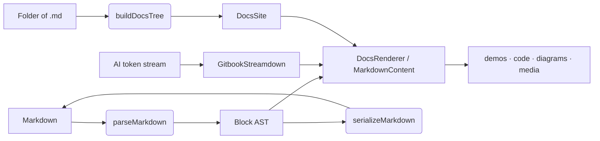

# docstream

docstream renders GitBook-flavored Markdown in React. One package takes you from an AI answer streaming into a chat pane, to a component page whose demos run the real source files, to a complete documentation site built from a folder of `.md` files — like this one.


Everything on this site is rendered by docstream itself: the sidebar and search come from [`DocsSite`](02-docs-site/README.md) reading the repo's `demo/docs/` folder, and every hint, tab, diagram and demo on every page is a live use of the renderer. Press **⌘K** to search, or use **Copy page ▾** to take any page into an AI chat.




## What's in the box

<table data-view="cards"><thead><tr><th></th><th></th></tr></thead><tbody>
<tr><td><strong>Docs sites from a folder</strong></td><td>Hand <code>DocsSite</code> a VFS; it finds the Markdown, builds a GitBook-style sidebar, search, outline and routing. <a href="02-docs-site/README.md">Docs sites →</a></td></tr>
<tr><td><strong>The whole GitBook syntax</strong></td><td>Hints, tabs, steppers, columns, cards, expandables, content refs, changelogs, task lists, frontmatter — parsed, rendered and serialized back byte for byte. <a href="03-writing/01-markdown-basics.md">Writing →</a></td></tr>
<tr><td><strong>Demos from real files</strong></td><td><code></code> renders a folder of components with its source, variants, viewports, resize and fullscreen. <a href="04-interactive/01-demos.md">Demos →</a></td></tr>
<tr><td><strong>Code that runs</strong></td><td>Live React fences and self-contained inline demos run in an in-browser Node (almost-node). <a href="04-interactive/03-live-code.md">Live code →</a></td></tr>
<tr><td><strong>Streaming AI answers</strong></td><td><code>GitbookStreamdown</code> renders blocks before they close, with citations, mentions and source previews. <a href="06-ai/01-streaming.md">Streaming →</a></td></tr>
<tr><td><strong>Diagrams and math</strong></td><td>Mermaid drawn by Pele, KaTeX math, both as source-and-result cards. <a href="03-writing/06-math-and-diagrams.md">Math and diagrams →</a></td></tr>
<tr><td><strong>Media</strong></td><td>Video, session replays, 3D models, live-coded music, OpenAPI operations, data viz. <a href="05-media/01-embeds-and-video.md">Media and embeds →</a></td></tr>
<tr><td><strong>Made for AI</strong></td><td>“Copy page” gives an AI the page with every demo's files inline; it pastes back into docstream intact. <a href="06-ai/03-page-actions.md">Page actions →</a></td></tr>
</tbody></table>

## Install

npm install @brett_lamy/docstream react react-dom



```tsx title="Page.tsx"
import { MarkdownContent } from "@brett_lamy/docstream"
import "@brett_lamy/docstream/styles.css"

export function Page({ markdown }: { markdown: string }) {
  return <MarkdownContent markdown={markdown} />
}
```



```tsx title="Answer.tsx"
import { GitbookStreamdown } from "@brett_lamy/docstream"
import "@brett_lamy/docstream/styles.css"

export function Answer({ text, done }: { text: string; done: boolean }) {
  return <GitbookStreamdown markdown={text} isStreaming={!done} />
}
```



```tsx title="main.tsx"
import { createRoot } from "react-dom/client"
import { DocsSite } from "@brett_lamy/docstream/site"
import "@brett_lamy/docstream/styles.css"

const files = import.meta.glob("./docs/**/*.md", { query: "?raw", import: "default", eager: true })
createRoot(document.getElementById("root")!).render(<DocsSite files={files} title="My docs" />)
```



Nothing in the install runs a build script. Heavy renderers — Pele for diagrams, KaTeX, rrweb, Strudel — load the first time a page needs them, and the opt-in features (the in-browser playground, viz scenes) live behind their own entries with optional peers. See [Installation](01-getting-started/01-installation.md) and [Package entries](01-getting-started/03-package-entries.md).

## How it fits together



The parser and serializer are a plain-data, lossless pair — `serializeMarkdown(parseMarkdown(md)) === md` — which is what lets [docstream-editor](https://github.com/BLamy/docstream-editor) edit these same pages visually without disturbing a byte you didn't touch. See [Parser and serializer](07-reference/02-parser-api.md).

## Where to next


Quick start — a rendered page, a streaming answer and a live demo in five minutes



Docs sites — publish a folder of Markdown as a site like this one

