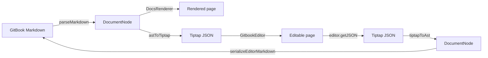

# With docstream

docstream-editor has no Markdown parser and no Markdown printer of its own. It reads a page with docstream's `parseMarkdown`, converts the AST to a Tiptap document, and on every edit converts back and writes the page with docstream's serializer. The renderer and the editor never disagree about what a page means, because there is only one definition of it.

## One AST, two views



| Step | Function | From |
| --- | --- | --- |
| Markdown → AST | `parseMarkdown(markdown)` | `@brett_lamy/docstream/gitbook` (also the root entry) |
| AST → editor | `astToTiptap(doc)` | `@brett_lamy/docstream-editor` / `…/convert` |
| editor → AST | `tiptapToAst(json)` | `@brett_lamy/docstream-editor` / `…/convert` |
| AST → Markdown | `serializeEditorMarkdown(doc)` | `@brett_lamy/docstream-editor` / `…/convert` |
| AST → Markdown (renderer side) | `serializeMarkdown(doc)` | `@brett_lamy/docstream/gitbook` |

`GitbookEditor` runs exactly this chain. When the `markdown` prop changes it calls `parseMarkdown` → `astToTiptap`. On every edit it calls `tiptapToAst(editor.getJSON())`, then `serializeEditorMarkdown`, then `onChange`.

## Byte for byte

docstream's parser and serializer are lossless: `serializeMarkdown(parseMarkdown(md)) === md` for any input. The editor keeps that property across a full trip through a real ProseMirror document. What the visual editor has no control for travels on hidden attributes:

| What the Markdown wrote | Where it rides in the editor |
| --- | --- |
| Blank lines, fence style, list markers (`*` / `-`, `1)` / `1.`), tag lines as written, raw HTML, image syntax | `md` attribute on every block (`GbMarkdownLayout`) |
| `*` vs `_`, `**` vs `__`, nesting order of emphasis | `delim` / `depth` on bold, italic, strike and link marks (`GbMarkSpelling`) |
| A link inside emphasis (`**[x](u)**`) vs emphasis inside a link (`[**x**](u)`) | `inner` on the link mark (`GbLinkInner`) |
| Link titles, reference labels, code-span backtick counts | `md` on the link and code marks |
| Backslash escapes (`snake\_case`) | the `mdEscaped` mark |
| Reference definitions, `` docstream doesn't know | `gbDefinition` / `gbRaw` blocks |
| Footnote definitions (`[^1]: url "Label"`) | kept by `GitbookEditor` beside the document and re-attached on serialize |
| YAML frontmatter | the `properties` attribute on the document node |

Try it. Pick a sample that a naive editor would "normalize", or paste your own page. The demo runs the same chain `GitbookEditor` does, through the editor's real schema:



What "byte for byte" covers:

- **Untouched content comes back exactly.** Open a page, edit one paragraph, and the diff is that paragraph.
- **What you edit is written in docstream's canonical form.** A mark you add gets the default spelling (`**bold**`, `_italic_`). A new list gets a marker that keeps it separate from a list right before it. When an edit leaves a layout detail meaningless, docstream drops it.
- **Splitting a block doesn't copy its layout** to the new second half.


`tiptapToAst` returns the body and frontmatter, but not footnote definitions: ProseMirror JSON has no place for them. If you run the conversion yourself, copy `citations` across the way `GitbookEditor` does: `back.citations = parseMarkdown(md).citations`. See [Conversion](../04-reference/02-conversion.md).


## `serializeEditorMarkdown`, not `serializeMarkdown`

For editor output, use `serializeEditorMarkdown`. It is docstream's `serializeMarkdown` with one difference. An attachment chip created in the editor has no recorded syntax, and `serializeEditorMarkdown` writes it as a Markdown image, ``. If the name has an unbalanced `]`, it keeps the `` form. Everything else is passed to docstream unchanged.

```ts title="save.ts"
import { parseMarkdown } from "@brett_lamy/docstream/gitbook"
import { astToTiptap, serializeEditorMarkdown, tiptapToAst } from "@brett_lamy/docstream-editor/convert"

const source = parseMarkdown(markdown)
const json = astToTiptap(source) // → editor content
const back = tiptapToAst(json) // ← editor.getJSON()
if (source.citations?.length) back.citations = source.citations
const saved = serializeEditorMarkdown(back) // === markdown
```

## The version rule


**docstream-editor's version always equals the docstream version it depends on.** docstream-editor `1.19.0` depends on `"@brett_lamy/docstream": "1.19.0"`, exactly, with no caret.


The conversion maps docstream's AST node by node. When docstream adds a block, an attribute or a layout field, the editor has to learn it in the same release, or pages would lose it on the way through. So the two ship together:

1. docstream publishes `X.Y.Z`.
2. The editor bumps its own version and its docstream dependency to the same `X.Y.Z`, and publishes.

The test `pins docstream to its own version` asserts `dependencies["@brett_lamy/docstream"] === version` on every run, so a release with mismatched numbers can't pass CI.

For your app:

- **If you also import docstream directly** (to render pages, run `DocsSite`, build a demo resolver), depend on the same version as the editor. Then your bundle has one copy, and its demo, VFS and asset contexts are shared with the editor's.
- **To upgrade, bump both** to the same number.

## Sharing more than the AST

Editor and renderer accept the same host plumbing, so a page looks the same in both:

| Pass the same… | To the editor as | To docstream as |
| --- | --- | --- |
| Demo resolver (`createGlobDemoResolver`) | `demoResolver` | `demoResolver` on `MarkdownContent` / `DocsRenderer` / `DocsSite` |
| Inline-demo runtime (`createAlmostNodeDemoRuntime()`) | `demoRuntime` | `demoRuntime` |
| Live-code renderer (`almostNodeLiveRenderer`) | `liveRenderer` | `liveRenderer` |
| Demo VFS (`useDemoVFS()`) | `demoVFS` | `demoVFS` |
| Asset resolver | `resolveAsset` | docstream's `AssetResolverProvider` |

Pasting a docs page's **Copy page ▾** output shows the same page in the editor, demos and their inline files included. Copying a demo out of the editor writes the same clipboard format docstream's own **Copy demo** button does. See [Demo blocks](../03-files-and-demos/04-demo-blocks.md).

For renderer details, go to docstream's own docs: the [parser and serializer](https://blamy.github.io/ui/#/docstream/reference/parser-api), the [AST](https://blamy.github.io/ui/#/docstream/reference/ast), [streaming AI answers](https://blamy.github.io/ui/#/docstream/ai/streaming), and [docs sites](https://blamy.github.io/ui/#/docstream/docs-site) like this one.

## Next


Conversion: every helper behind the round trip, with signatures and a live inspector



Editing surface: every block the editor edits, and how

