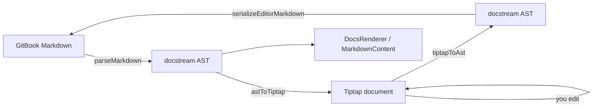

# docstream-editor

`@brett_lamy/docstream-editor` edits the Markdown that [docstream](https://blamy.github.io/ui/#/docstream) renders. Hints, tabs, steppers, install boxes, live demos, Mermaid, math, task states and frontmatter all show up as real blocks you can edit. When you're done, it hands back GitBook-flavored Markdown: the parts you edited are re-serialized, and everything else comes back byte for byte.


This site is itself a folder of Markdown, published with docstream's [`DocsSite`](https://blamy.github.io/ui/#/docstream/docs-site). Every editor on these pages is a real, mounted `GitbookEditor`. Open **Copy page ▾** on any page and paste the result into the playground below: the editor shows the same page.




## What it edits

<table data-view="cards"><thead><tr><th></th><th></th></tr></thead><tbody>
<tr><td><strong>The whole GitBook syntax</strong></td><td>Headings, lists, tables, hints, tabs, steppers, expandables, columns, embeds, content refs, changelogs, OpenAPI operations: each one is an editable block. <a href="02-editing/01-editing-surface.md">Editing surface →</a></td></tr>
<tr><td><strong>A slash menu</strong></td><td>Type <code>/</code> to insert any block. Swap in your own items with <code>slashMenu={{ items }}</code>. <a href="02-editing/02-slash-menu.md">Slash menu →</a></td></tr>
<tr><td><strong>Mentions, tags, citations</strong></td><td><code>@</code>, <code>#</code> and <code>$</code> pickers fed by static lists or async search, plus <code>[^1]</code> citations. <a href="02-editing/03-references-and-citations.md">References →</a></td></tr>
<tr><td><strong>Code, math, diagrams</strong></td><td>WebGPU-highlighted code with titles and line numbers, Mermaid with a live preview, KaTeX math, live fences. <a href="02-editing/04-code-math-and-diagrams.md">Code and diagrams →</a></td></tr>
<tr><td><strong>Tables and layout</strong></td><td>GFM tables with their alignment, card tables, columns, steppers. <a href="02-editing/05-tables-and-layout.md">Tables and layout →</a></td></tr>
<tr><td><strong>Properties and tasks</strong></td><td>YAML frontmatter as an editable property sheet, and eight task states with docstream's icons. <a href="02-editing/06-properties-and-tasks.md">Properties and tasks →</a></td></tr>
<tr><td><strong>Images and attachments</strong></td><td>Pasted images go in inline as data URLs, or as attachment chips whose files the host stores. <a href="03-files-and-demos/01-images-and-attachments.md">Images →</a></td></tr>
<tr><td><strong>Files from your project</strong></td><td><code>resolveAsset</code>, <code>pickFile</code>, <code>uploadFile</code> and <code>onDropEmbeds</code> connect the editor to the folder a page lives in. <a href="03-files-and-demos/02-host-files.md">Host files →</a></td></tr>
<tr><td><strong>Real source files</strong></td><td><code></code> blocks edit the component behind them and autosave it through docstream's Vite plugin. <a href="03-files-and-demos/03-source-files.md">Source files →</a></td></tr>
<tr><td><strong>Live demos</strong></td><td><code></code> blocks preview with docstream's DemoViewer. Their inline files are editable, and you can copy, paste or drag them between editors. <a href="03-files-and-demos/04-demo-blocks.md">Demo blocks →</a></td></tr>
<tr><td><strong>Compose your own</strong></td><td><code>createGitbookExtensions</code> and <code>getGitbookSchema</code> let you build your own <code>useEditor</code>, Yjs collaboration included. <a href="03-files-and-demos/05-extensions.md">Extensions →</a></td></tr>
<tr><td><strong>Reference</strong></td><td>Every prop, every export, the conversion helpers, theming tokens and bundler notes. <a href="04-reference/01-props.md">Reference →</a></td></tr>
</tbody></table>

## Install

npm install @brett_lamy/docstream-editor @tiptap/core @tiptap/extension-code @tiptap/extension-code-block @tiptap/extension-list @tiptap/extension-placeholder @tiptap/extension-table @tiptap/pm @tiptap/react @tiptap/starter-kit @tiptap/suggestion react react-dom

React and the ten Tiptap packages are peer dependencies. docstream comes along as a regular dependency, pinned to the editor's own version. See [Installation](01-getting-started/01-installation.md).



```tsx title="EditorPage.tsx"
import { useState } from "react"
import { GitbookEditor } from "@brett_lamy/docstream-editor"
import "@brett_lamy/docstream/styles.css"
import "@brett_lamy/docstream-editor/styles.css"

export function EditorPage({ initial }: { initial: string }) {
  const [markdown, setMarkdown] = useState(initial)
  return <GitbookEditor markdown={markdown} onChange={setMarkdown} />
}
```



```tsx title="SplitView.tsx"
import { useState } from "react"
import { MarkdownContent } from "@brett_lamy/docstream"
import { GitbookEditor } from "@brett_lamy/docstream-editor"

export function SplitView({ initial }: { initial: string }) {
  const [markdown, setMarkdown] = useState(initial)
  return (
    <div style={{ display: "grid", gridTemplateColumns: "1fr 1fr" }}>
      <GitbookEditor markdown={markdown} onChange={setMarkdown} />
      <MarkdownContent markdown={markdown} />
    </div>
  )
}
```



```tsx title="Review.tsx"
import { GitbookEditor } from "@brett_lamy/docstream-editor"

export function Review({ markdown }: { markdown: string }) {
  return <GitbookEditor markdown={markdown} toolbar={false} editable={false} />
}
```



## Editing and reading look the same

The editor's stylesheet mirrors docstream's renderer block for block: same radii, same hint palette, same typography. The read-only editor and docstream's `MarkdownContent` render the same string below. Switch between them.



## How it pairs with docstream



The editor never parses or prints Markdown on its own. It calls docstream's `parseMarkdown`, converts the AST to Tiptap JSON and back, and writes the result with docstream's serializer. Layout details the visual editor has no control for (blank lines, list markers, fence styles, tag spellings, escapes) ride along on hidden node attributes, so anything you didn't touch comes back byte for byte. Both packages ship in lockstep: docstream-editor `1.19.0` depends on docstream `1.19.0`, exactly. See [With docstream](01-getting-started/03-with-docstream.md).

## Where to next


Quick start: an editor and a live docstream preview sharing one string, in four steps



GitbookEditor props: every prop, its type, default and effect

