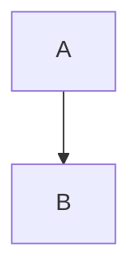

# Button

A **bold** claim, _emphasis_, `inline code`, ~~struck~~ and a [link](https://example.com). Ask @brett about #buttons [^1].

## Install



```sh
npm install @brett_lamy/ui
```



```sh
pnpm add @brett_lamy/ui
```




Buttons need a **label**.

- even icon buttons
- use `aria-label`




npm install @brett_lamy/ui

Import the stylesheet once, then the parts:

```tsx
import '@brett_lamy/ui/styles.css'
import { Button } from '@brett_lamy/ui'
```



npx shadcn@latest add https://example.com/r/button.json




npm install -D vitest
npm run test -- --watch


## Usage

```tsx title="App.tsx"
import { Button } from "@brett_lamy/ui"

export default function App() {
  return <Button>Save</Button>
}
```

```ts lineNumbers="false"
const quiet = true
```




```tsx title="index.tsx"
import { messages } from "./data"

export default function ScrollFab({ variant = "full" }: { variant?: string }) {
  return <ul data-variant={variant}>{messages.map((m) => <li key={m}>{m}</li>)}</ul>
}
```
```ts title="data.ts"
export const messages = ["one", "two", "three"]
```
````md title="README.md"
Run it:

```sh
npm start
```
````








Ghost buttons sit on busy surfaces.



## API

| Prop | Type | Default |
| --- | --- | --- |
| `variant` | `"solid" \| "ghost"` | `"solid"` |
| `size` | `"sm" \| "lg"` | `"sm"` |

<table data-view="cards"><thead><tr><th>Title</th><th>Body</th></tr></thead><tbody><tr><td><strong>Solid</strong></td><td>Primary actions</td></tr><tr><td><strong>Ghost</strong></td><td>Secondary actions</td></tr></tbody></table>







### Install

Add the package.



### Import

Import the component.





Left column.



Right column.



<details>

<summary>Why not a link?</summary>

Links navigate; buttons act.

</details>

1. First
2. Second
  - nested bullet

- [x] Done
- [ ] Todo

> Buttons are verbs.

---

$$
E = mc^2
$$



<figure><figcaption><p>The default button</p></figcaption></figure>




[Card](card.md)




Added the ghost variant.




[petstore](https://petstore3.swagger.io/api/v3/openapi.json)


[^1]: https://example.com/buttons "Button guidelines"
